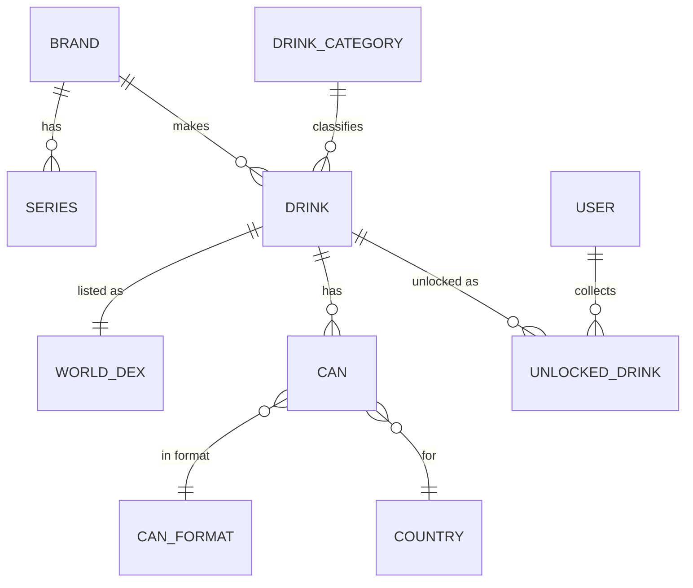
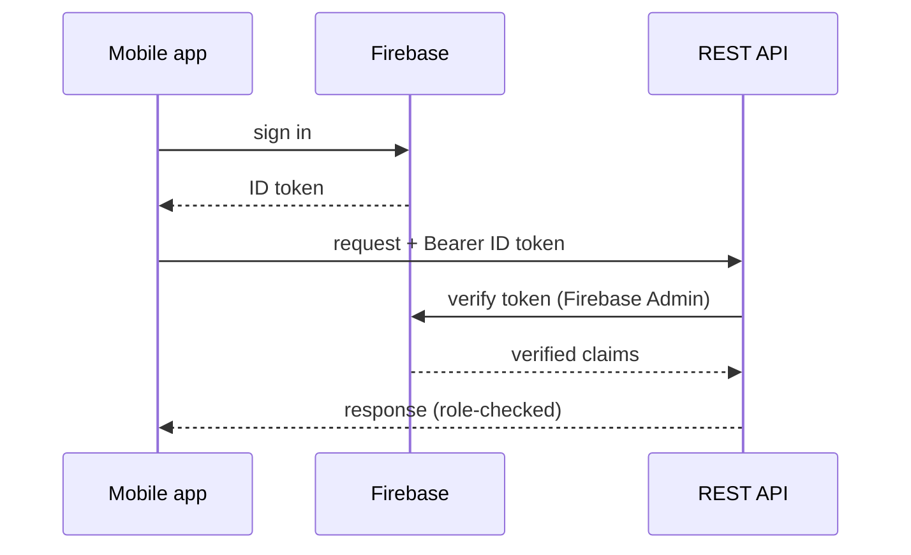

This is the map of how Candex is built. It stays high-level and links out: the **Back-end**, **Front-end**, **Database**, and **Deployment** handbooks go deep on each area. For the moving parts and repositories, see [Working on Candex](/en/getting-started-dev/).

## The domain model

The catalogue is a graph of entities around **Drink**. A drink belongs to a **brand** and a **category**, is listed once in the **World Dex**, and has one or more **cans** (per country, format, and colours). Users build their collection by **unlocking** drinks.

Around this core sit supporting entities — `Flavor` (with categories and translations), `Color`, `Language`, `DrinkLocalization`, and `WorldDexArrival` / `WorldDexHistory` for ordering. Catalogue entities (`Brand`, `Series`, `Flavor`, `CanFormat`) carry an **`introduced_in_version`** link to `AppVersion`, so the catalogue is versioned alongside the app. The full entity model is in the **[Database & Model](/en/database/)** handbook.

## API structure

`candex-api` is a layered Spring Boot application under `dev.ruster.candex`:

| Layer | Package | Responsibility |
|-------|---------|----------------|
| Web | `controller` | REST endpoints |
| Contract | `dto` (`request` / `response`), `mapper` | API shapes, mapped to/from entities with MapStruct |
| Business | `service` (`core`, `analysis`) | Domain logic |
| Data | `repository`, `entity` | Spring Data JPA over PostgreSQL |
| Cross-cutting | `security`, `exception`, `validation`, `config`, `job` | Auth, errors, validation, config, scheduled jobs |

The `dto` + `mapper` boundary keeps the API contract decoupled from the JPA model — controllers never expose entities directly.

## Authentication & security

The app signs in through **Firebase**; the API verifies the Firebase ID token on every request (`FirebaseAuthenticationFilter` / `FirebaseAuthenticationService`, backed by the Firebase Admin SDK) and authorises by role (`ROLE_ADMIN`, `ROLE_USER`).

## Data & migrations

The domain lives in **PostgreSQL**. The schema is owned by **Flyway** migrations under `candex-api/src/main/resources/db/migration`: every change is a versioned `V__*.sql` file, and seed data (brands, app versions, and more) ships as migrations too — which is why a fresh database comes up usable. A read-only SQL-console role is provisioned by migration for safe inspection.

## The front-ends

Both front-ends are Angular + Ionic and talk to the same REST API.

- **Mobile app** (`candex-app`) — state managed with **NgRx**, organised into feature slices: `auth`, `dex`, `drink`, `user`, `preferences`, `app`.
- **Admin dashboard** (`candex-dashboard`) — Angular + **Angular Material**, used to keep the catalogue accurate.

See the **[Front-end](/en/front-end/)** handbook for structure and conventions.

## Deployment topology

Each environment is a Docker Compose stack of an **API** container and a **PostgreSQL 17** container:

| Environment | Compose file | Notes |
|-------------|--------------|-------|
| local | `compose.local.yaml` | Throwaway stack via `scripts/candex.sh` (see [Local Installation](/en/local-installation/)) |
| dev | `compose.dev.yaml` | `api-dev` + `db-dev`; API on host `8081`, debug `5005` |
| prod | `compose.prod.yaml` | `api-prod` + `db-prod` |

:::note[To confirm]
TLS and reverse proxying are not in these compose files, though a `CADDY_EMAIL` variable exists — so the public entrypoint (likely **Caddy**) appears to be handled at the server level. The **[Deployment](/en/deployment/)** handbook documents the exact topology.
:::

## Design notes

Grounded from the code and config; items marked *to confirm* need your input.

- **Layered API with a DTO/mapper boundary** — the `dto` + `mapper` packages keep the public contract separate from the JPA entities, so the database model can evolve without breaking clients.
- **Firebase for identity, PostgreSQL for the domain** — authentication is delegated to Firebase while all catalogue and collection data is relational in Postgres (evident from the dependencies and config).
- **Flyway-owned schema** — the database is never edited by hand; every change is a versioned migration, which also makes local setup reproducible.
- **Separate admin dashboard** — catalogue management is a distinct app from the consumer mobile app. *(Rationale to confirm.)*
- **Versioned catalogue** — catalogue entities reference `AppVersion`. *(Intended use to confirm.)*

## Where to go next

- The data model → [Database](/en/database/)
- The API layers → [Back-end](/en/back-end/)
- The front-end → [Front-end](/en/front-end/)
