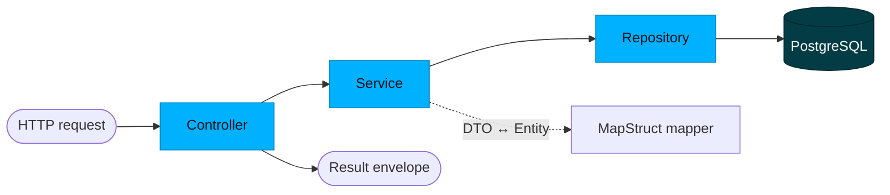

`candex-api` is a layered Spring Boot application. This handbook covers how it is built; for the domain it serves, see [Database & Model](/en/database/), and for the system around it, [Architecture & Overview](/en/architecture/).

## Request flow

Every request flows through the same layers. Controllers return a typed **`Result`** envelope; services hold the logic; repositories are Spring Data JPA; and the boundary between the JPA entities and the API shapes is crossed by **MapStruct** mappers.



## The response envelope

Every endpoint returns a generic `Result<T>`:

```json
{ "success": true, "data": { "...": "..." }, "error": null }
```

- `data` carries the payload on success; `error` carries a structured error on failure; `success` is the flag.
- Collection responses add an **`X-Total-Count`** header; creations add a **`Location`** header.

## API surface

Resource paths are centralised in `ApiPaths` and exposed under the API base (for example `/api/drinks`). Around **45 endpoints** across ~14 resources (28 `GET`, 9 `POST`, 4 `DELETE`, 3 `PUT`, 1 `PATCH`):

| Resource | Path |
|----------|------|
| Drinks | `/drinks` (incl. bulk `import`, `import/diff`, `import/sync`) |
| Cans · Can formats | `/cans` · `/can-formats` |
| Brands | `/brands` |
| Flavors · Flavor categories | `/flavors` · `/flavor-categories` |
| Colors · Drink categories | `/colors` · `/drink-categories` |
| World Dex | `/world-dex` |
| Users · Unlocked drinks | `/users` · `/user-unlocked-drinks` |
| App versions · Reports | `/app-versions` · `/reports` |
| Admin SQL console | `/admin/...` |

Interactive docs live at **Swagger UI** (`/swagger-ui.html`). The exact request/response contracts belong to the **API / Contracts** handbook *(planned)*.

## Authorization

Endpoints are guarded with `@PreAuthorize` and `SecurityExpressions`:

| Rule | Used for |
|------|----------|
| `USER_OR_ADMIN` | Authenticated reads (the catalogue, the World Dex) |
| `ADMIN_ONLY` | Catalogue writes and admin operations |
| `PERMIT_ALL` | The few public endpoints |
| `@securityAccess.canAccessUserId(...)` | User-owned data — a user may only touch their own records |

Identity itself comes from Firebase (see [Architecture & Overview](/en/architecture/#authentication--security)).

## Services & business logic

The domain logic sits in `service/core` — one service per resource (`DrinkService`, `BrandService`, `WorldDexService`, `UserService`, …) — plus supporting services: `ImageService` (analysis), `UploaderService` (media), `ReportService`, and `SqlConsoleService`.

## Error handling

Errors are returned in the `Result` envelope's `error` field. Exceptions derive from a common `CustomException` and fall into two families:

| Family | Examples |
|--------|----------|
| `exception/api` | `ElementNotFoundException`, `InvalidFieldValueException`, `UniqueConstraintViolationException`, `ImmutableFieldModificationException`, `MissingRequiredFieldException`, `SqlExecutionException` |
| `exception/business` | `InvalidDexPositionException`, `MissingRequiredCanException`, `MissingRequiredLocalizationException`, `DrinkAlreadyHasPredecessorException`, `InvalidEditionConfigurationException` |

`api` exceptions describe request/data problems; `business` exceptions describe domain-rule violations.

## Validation

Request DTOs are validated with Bean Validation, wired through `ValidationConfig`. Invalid input surfaces as an `api` error rather than reaching the service layer.

## Scheduled jobs

Two background jobs run on a schedule:

- `UnverifiedUserCleanupJob` — removes users who never verified their account.
- `WorldDexHistoryPruneJob` — trims old World Dex history.

## Configuration

Configuration lives in `config` and is profile-aware (`dev` / `prod`): `OpenApiConfig` (Swagger), `CorsConfig` (allowed origins), `JacksonConfig` (JSON), `SqlConsoleConfig`, and `ValidationConfig`. To run it locally, see [Local Installation](/en/local-installation/); environment specifics belong to the **Deployment** handbook *(planned)*.

## Conventions

- Controllers return `ResponseEntity<Result<T>>`; paths come from `ApiPaths` constants.
- Entities never leave the service boundary — DTOs (`dto/request`, `dto/response`) cross it via MapStruct mappers.
- Every endpoint declares its access with `@PreAuthorize`.
- Errors are structured exceptions (`api` / `business`) surfaced through the `Result` envelope.
