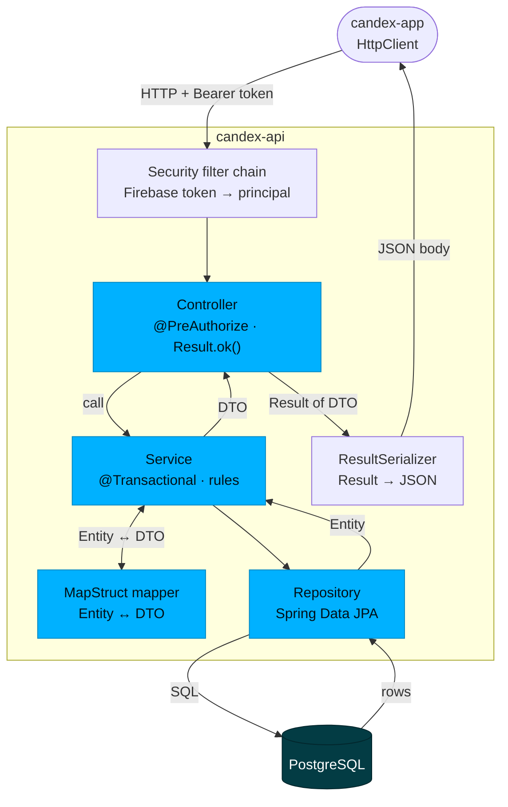
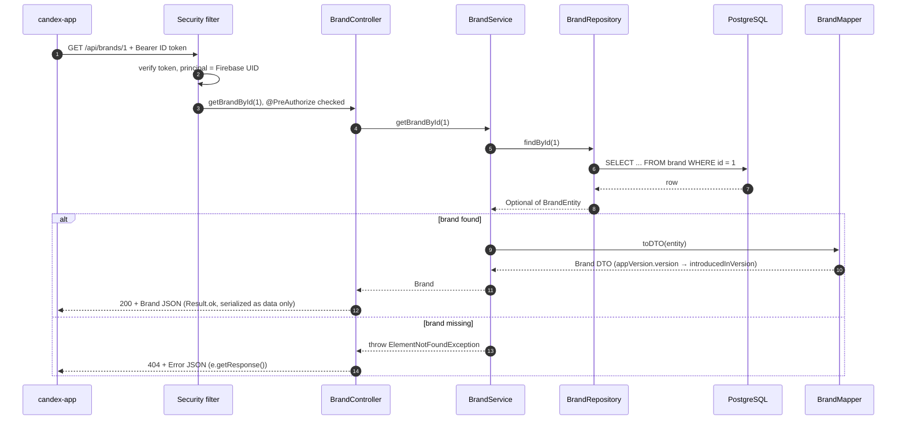

`candex-api` is a layered Spring Boot application. This handbook covers how it is built; for the domain it serves, see [Database & Model](/en/database/), and for the system around it, [Architecture & Overview](/en/architecture/).

## Request flow

Every request flows through the same layers. Controllers return a typed **`Result`** envelope; services hold the logic; repositories are Spring Data JPA; and the boundary between the JPA entities and the API shapes is crossed by **MapStruct** mappers.



### A request, end to end

`GET /brands/{id}` as it really runs — `BrandController` → `BrandService` → `BrandRepository` → `BrandMapper`. Every read follows this shape; writes run it in reverse (DTO → `toEntity` → `save`).



Three things to notice:

- **The entity never leaves the service.** The mapper runs inside the service, so the controller only ever sees DTOs.
- **Exceptions are caught in the controller**, not in a global `@ControllerAdvice`: each endpoint lists the `CustomException`s it expects and returns `e.getResponse()`. An exception it does not catch falls through to Spring's default error handling.
- **Transactions live on the service**, on the write paths (`@Transactional` on `createUser`, `DrinkService` imports, …). Plain reads like this one have none: lazy relations are resolved by the mapper thanks to Spring's default *open-in-view*, which keeps the JPA session open for the whole request.

### The same request in code

The three classes behind that request, trimmed of their Swagger annotations. This is the template every resource follows.

The **controller** declares the route and the access rule, delegates, and turns the outcome into a response — nothing else:

```java
@RestController
@RequiredArgsConstructor
@RequestMapping(ApiPaths.BRANDS)
@PreAuthorize(SecurityExpressions.USER_OR_ADMIN)
public class BrandController {

    private final BrandService brandService;

    @GetMapping("/{id}")
    public ResponseEntity<Result<Brand>> getBrandById(@PathVariable int id) {
        try {
            return Result.ok(brandService.getBrandById(id));
        } catch (ElementNotFoundException e) {
            return e.getResponse();
        }
    }
}
```

The **service** reads through the repository, raises a typed exception when a rule fails, and hands back a DTO — the entity never escapes:

```java
@Service
@RequiredArgsConstructor
public class BrandService {

    private final BrandRepository brandRepository;
    private final BrandMapper brandMapper;

    public Brand getBrandById(int id) {
        return brandMapper.toDTO(brandRepository.findById(id).orElseThrow(
                () -> new ElementNotFoundException(BrandEntity.class, "id", id)
        ));
    }
}
```

The **mapper** is an interface: MapStruct generates the implementation at compile time. Fields with the same name map themselves; only the differences are declared:

```java
@Mapper(componentModel = "spring")
public interface BrandMapper {

    @Mapping(source = "appVersion.version", target = "introducedInVersion")
    Brand toDTO(BrandEntity entity);

    List<Brand> toDTO(List<BrandEntity> entityList);

    @Mapping(target = "id", ignore = true)
    @Mapping(target = "createdAt", ignore = true)
    @Mapping(target = "updatedAt", ignore = true)
    @Mapping(source = "introducedInVersion", target = "appVersion.version")
    BrandEntity toEntity(Brand dto);
}
```

Each layer has exactly one job:

| Layer | Responsibility | Must not |
|-------|----------------|----------|
| **Controller** | Map HTTP to a method, enforce access (`@PreAuthorize`), return a `Result`. Thin. | Hold business logic or touch the database |
| **Service** (`service/core`) | The business logic: orchestration, transactions, rule checks, calling repositories, mapping entities ↔ DTOs, raising exceptions. | Know anything about HTTP |
| **Repository** | Spring Data JPA access to one aggregate — derived and custom queries. | Hold business rules |
| **Entity** | The JPA domain model (persisted state). | Leave the service boundary |
| **DTO** (`dto/request`, `dto/response`) | The API's input and output shapes. | Carry persistence concerns |
| **Mapper** (MapStruct) | Convert entities ↔ DTOs at the service boundary. | — |
| **Cross-cutting** (`security`, `exception`, `validation`, `config`, `job`, `result`) | Auth, structured errors, input validation, configuration, scheduled jobs, the response envelope. | — |

The golden rule: entities never reach the controller, and controllers never hold logic.

## The response envelope

Every endpoint returns a generic `Result<T>` in Java — but **the envelope is not what goes over the wire**. `ResultSerializer` unwraps it: on success the body is the bare `data`, on failure the bare `Error`. The HTTP status is the success flag.

`200` — `GET /brands/1`:

```json
{
  "id": 1,
  "name": "Monster Energy",
  "introducedInVersion": "1.0.0"
}
```

`404` — `GET /brands/999`:

```json
{
  "name": "ElementNotFoundException",
  "message": "BrandEntity not found for id = 999.",
  "status": 404,
  "timestamp": "2026-11-12 20:52:52"
}
```

- This is why the app types its calls directly as `http.get<Brand>(...)` — there is no `.data` to unwrap.
- Collection responses add an **`X-Total-Count`** header; creations add a **`Location`** header.

## API surface

Resource paths are centralised in `ApiPaths` and exposed under the API base (for example `/api/drinks`). Around **45 endpoints** across ~14 resources (28 `GET`, 9 `POST`, 4 `DELETE`, 3 `PUT`, 1 `PATCH`):

| Resource | Path |
|----------|------|
| Drinks | `/drinks` (incl. bulk `import`, `import/diff`, `import/sync`) |
| Cans · Can formats | `/cans` · `/can-formats` |
| Brands | `/brands` |
| Flavors · Flavor categories | `/flavors` · `/flavor-categories` |
| Colors · Drink categories | `/colors` · `/drink-categories` |
| World Dex | `/world-dex` |
| Users · Unlocked drinks | `/users` · `/user-unlocked-drinks` |
| App versions · Reports | `/app-versions` · `/reports` |
| Admin SQL console | `/admin/...` |

Interactive docs live at **Swagger UI** (`/swagger-ui.html`). The exact request/response contracts belong to the **[API / Contracts](/en/api-contracts/)** handbook.

## Authorization

Endpoints are guarded with `@PreAuthorize` and `SecurityExpressions`:

| Rule | Used for |
|------|----------|
| `USER_OR_ADMIN` | Authenticated reads (the catalogue, the World Dex) |
| `ADMIN_ONLY` | Catalogue writes and admin operations |
| `PERMIT_ALL` | The few public endpoints |
| `@securityAccess.canAccessUserId(...)` | User-owned data — a user may only touch their own records |

Identity itself comes from Firebase (see [Architecture & Overview](/en/architecture/#authentication--security)).

## Services & business logic

The domain logic sits in `service/core` — one service per resource (`DrinkService`, `BrandService`, `WorldDexService`, `UserService`, …) — plus supporting services: `ImageService` (analysis), `UploaderService` (media), `ReportService`, and `SqlConsoleService`.

## Error handling

Every exception extends a common `CustomException`, which **carries its own `HttpStatus`** and serialises into the `Result` envelope's `error` field (a `dto/response/Error` holding the message and status code). Exceptions fall into two families.

**API errors** (`exception/api`) — request and data problems:

| Exception | HTTP | Raised when |
|-----------|------|-------------|
| `ElementNotFoundException` | 404 | A referenced entity does not exist |
| `InvalidFieldValueException` | 400 | A field has an invalid format or value |
| `MissingRequiredFieldException` | 400 | A required field is absent |
| `UnsupportedFieldException` | 400 | An unknown/unsupported field is used |
| `InvalidImportPayloadException` | 400 | A bulk-import payload is malformed |
| `SqlExecutionException` | 400 | A SQL-console query fails |
| `ImmutableFieldModificationException` | 409 | A create-only field is changed after creation |
| `UniqueConstraintViolationException` | 409 | A uniqueness constraint is violated |
| `MissingConfigurationException` | 422 | Required configuration (e.g. an app version) is missing |

**Business errors** (`exception/business`) — domain-rule violations:

| Exception | HTTP | Raised when |
|-----------|------|-------------|
| `MissingRequiredCanException` | 400 | A drink is saved without any can |
| `MissingRequiredLocalizationException` | 400 | A drink is saved without any localization |
| `InvalidDexPositionException` | 400 | A World Dex position is out of range |
| `InvalidEditionConfigurationException` | 400 | An edition / variant is misconfigured |
| `DrinkAlreadyHasPredecessorException` | 409 | A drink is linked as predecessor to two drinks |
| `ImageAnalysisException` | 422 | Image analysis fails |

In short: `api` exceptions describe what is wrong with the request; `business` exceptions describe which domain rule was broken.

An exception knows how to turn itself into a response, which is what lets a controller reply with a one-liner (`return e.getResponse();`):

```java
// CustomException (abstract, extends RuntimeException) — the base of every api / business exception
public <T> ResponseEntity<Result<T>> getResponse() {
    Error errorDTO = new Error(
            getClass().getSimpleName(),   // "ElementNotFoundException"
            getMessage(),
            status.value()                // the HttpStatus given in the constructor
    );
    return ResponseEntity.status(status).body(new Result<>(errorDTO));
}
```

A new rule therefore only needs a new subclass that passes its status up:

```java
public class UniqueConstraintViolationException extends CustomException {

    public UniqueConstraintViolationException(Class<?> entity, String field, String value) {
        super(
                "A %s with %s = '%s' already exists."
                        .formatted(entity.getSimpleName(), field, value),
                HttpStatus.CONFLICT
        );
    }
}
```

## Validation

Request DTOs are validated with Bean Validation, wired through `ValidationConfig`. Invalid input surfaces as an `api` error rather than reaching the service layer.

## Scheduled jobs

Two background jobs run on a schedule:

- `UnverifiedUserCleanupJob` — removes users who never verified their account.
- `WorldDexHistoryPruneJob` — trims old World Dex history.

## Configuration

Configuration lives in `config` and is profile-aware (`dev` / `prod`): `OpenApiConfig` (Swagger), `CorsConfig` (allowed origins), `JacksonConfig` (JSON), `SqlConsoleConfig`, and `ValidationConfig`. To run it locally, see [Local Installation](/en/local-installation/); environment specifics belong to the **[Deployment](/en/deployment/)** handbook.

## Conventions

- Controllers return `ResponseEntity<Result<T>>`; paths come from `ApiPaths` constants.
- Entities never leave the service boundary — DTOs (`dto/request`, `dto/response`) cross it via MapStruct mappers.
- Every endpoint declares its access with `@PreAuthorize`.
- Errors are structured exceptions (`api` / `business`) surfaced through the `Result` envelope.

## Where to go next

- The data it persists → [Database](/en/database/)
- The endpoints it exposes → [API / Contracts](/en/api-contracts/)
- How it's secured → [Security](/en/security/)
- How it's tested → [Testing](/en/testing/)
