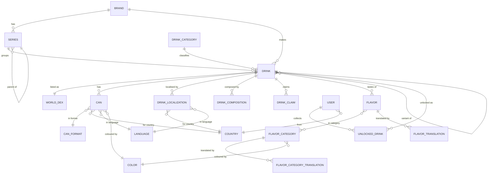

This is the reference for Candex's data. The domain lives in **PostgreSQL**, and the schema is owned entirely by **Flyway** migrations. For the big picture and the simplified core, see [Architecture & Overview](/en/architecture/).

## Schema organisation

The baseline schema is laid down by migrations `V1`–`V6`, in three areas plus the runtime machinery:

| Migration | Area |
|-----------|------|
| `V1` — core reference schema | Reference tables: countries, languages, colours, categories, app versions |
| `V2` — user data schema | Users and their unlocked drinks |
| `V3` — catalogue & dex schema | Brands, series, drinks, cans, flavours, World Dex |
| `V4` — runtime routines | PostgreSQL functions |
| `V5` — runtime triggers | Triggers that keep the World Dex ordered |
| `V6` — static reference data | Seeds the reference tables |

## The entity model

The catalogue is a graph around **Drink**. A drink belongs to a brand, a series, and a category; has cans, localisations, compositions, and claims; tastes of one or more flavours; and is listed once in the World Dex. Users collect drinks by unlocking them.

A few points the diagram abstracts:

- **Versioned catalogue.** Most catalogue and reference entities (`Brand`, `Series`, `Flavor`, `Color`, `Country`, `Language`, `DrinkCategory`, `CanFormat`, `User`) carry an `introduced_in_version` link to `AppVersion`, so every row is tied to the app version that introduced it. These edges are left out of the diagram to keep it readable.
- **Composite-key join tables.** `UserUnlockedDrink` (user + drink), `DrinkLocalization` (drink + country + language), `FlavorTranslation`, `FlavorCategoryTranslation`, and `DrinkCountry` use composite primary keys (see `entity/id`).
- **World Dex ordering.** `WorldDexArrival` and `WorldDexHistory` track the order and arrival of entries; that order is maintained in the database (see below).

## Reference & seed data

Reference tables (countries, languages, colours, drink categories, can formats) and the first app versions are seeded by migrations, so a fresh database is immediately usable. Brand and series baselines (for example Monster and Coca-Cola) are seeded in later migrations (`V13`, `V14`). Because the catalogue is versioned, reference and catalogue rows are introduced against a specific `AppVersion`.

## Migrations & Flyway

Flyway owns the schema (`spring.flyway.enabled=true`, `locations=classpath:db/migration`).

- `V1`–`V6` are the **canonical baseline** for empty databases; existing non-empty databases are baselined at version `6`.
- Every later change is an **incremental** `V7+` migration.
- Applied migrations are **immutable** — never rename, reorder, or edit a migration after it has been deployed.
- Legacy snapshot scripts are kept under `src/main/resources/sql/archive/`.

To change the schema or reference data, add the next `V<n>__short_description.sql` file; it runs automatically the next time the API starts.

## World Dex ordering

The World Dex is an **ordered** catalogue, and that order is kept consistent **in the database** rather than in the app. PostgreSQL routines (`V4`) and triggers (`V5`) shift entries when drinks are inserted or deleted, so positions stay contiguous and correct. This ordering logic has been refined across several migrations (`V9`, `V12`, `V17`–`V20`); the migration files are the source of truth for the exact behaviour. The **[Back-end](/en/back-end/)** handbook covers how the API exposes this.

## Read-only SQL console

Migration `V16` provisions a **read-only database role** for safe inspection. Its password comes from the Flyway placeholder `readonly_password` (`CANDEX_SQLCONSOLE_READONLY_PASSWORD`). This role backs the admin dashboard's SQL console, so queries can be run against the database without write access.

## Conventions

- Tables and columns are `snake_case`; foreign keys are `<entity>_id` (or a natural code such as `country_code`, `language_code`).
- Join and translation tables use **composite primary keys**, defined in `entity/id`.
- Migrations are **versioned and immutable**; the database is never edited by hand.
- Catalogue and reference rows are tied to an `AppVersion` via `introduced_in_version`.

## Where to go next

- The layers that use it → [Back-end](/en/back-end/)
- The terms behind the tables → [Glossary](/en/glossary/)
- How it's backed up → [Backups](/en/backups/)
