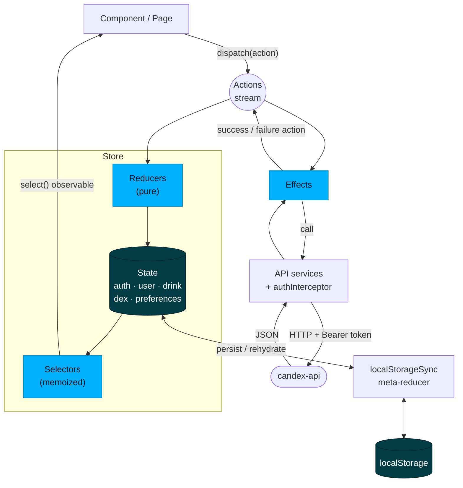
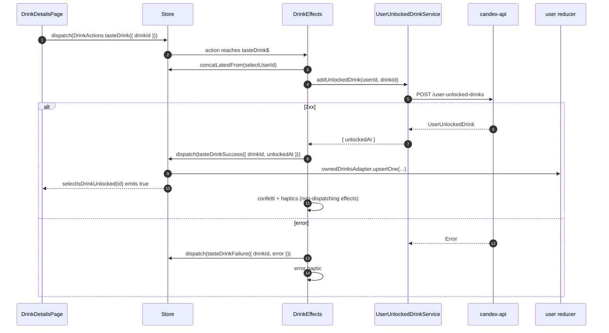

Candex has two Angular + Ionic front-ends that consume the same [Back-end](/en/back-end/): the **mobile app** users hold, and the **admin dashboard** that keeps the catalogue accurate. For the system around them, see [Architecture & Overview](/en/architecture/).

## Mobile app (`candex-app`)

Angular 20 + Ionic 8 + Capacitor 7, built with **standalone components** (no NgModules), feature-structured, with **NgRx** for state.

### Layers & their roles

| Layer | Folder | Role |
|-------|--------|------|
| **Pages** | `pages` | Routed screens: the auth flow, the `tabs` shell (home / dex / profile), drink details, and settings |
| **Components** | `components` | Reusable UI pieces shared across pages |
| **Services** | `services` | Side-effects & integrations: the API client (`api`), plus `auth`, `storage`, `theme`, `language`, `upload-care`, `haptics`, `native-app`, `dex-navigation` / `dex-ui`, `ui-alert`, and `app-initializer` |
| **Store** | `store` | NgRx state — one slice per domain (see below) |
| **Guards** | `guards` | Route protection (`auth`, `app`) — keep unauthenticated users out of protected screens |
| **Interceptors** | `interceptors` | `auth.interceptor` attaches the Firebase token to every API request |
| **Pipes** | `pipes` | View formatting — e.g. `dynamic-locale-date` for localized dates |

The principle mirrors the back-end: **components render and dispatch; services and the store do the work**. A component never calls the API directly.

### State with NgRx

State is split into slices — `app`, `auth`, `dex`, `drink`, `preferences`, `user` — each a complete NgRx unit (`actions`, `reducer`, `effects`, `selectors`, `state`). The flow is one-way:



The rules behind the picture:

- **Components only dispatch and select.** Every action goes into a single stream; **reducers** and **effects** both listen to it. A component never knows which of the two handles an action.
- **Reducers are pure** — `(state, action) → new state`, no I/O. Collections are `@ngrx/entity` adapters (`drinksAdapter` for the catalogue, `ownedDrinksAdapter` for the user's collection).
- **Effects own the side-effects** — HTTP, Firebase, navigation, toasts, haptics — and always answer with a new action (`…Success` / `…Failure`), never by writing to state themselves.
- **Slices react to each other through actions**, not imports: `drink` effects emit `tasteDrinkSuccess`, and it is the `user` reducer that records the owned drink.
- **Selectors join slices**: `DrinkSelectors.selectDrinks` merges the catalogue (`drink`) with the owned drinks (`user`) into `DrinkWithUnlock`, so each drink carries its `unlockedAt` without being stored twice.
- **Persistence** — the `localStorageSync` meta-reducer (in `main.ts`) mirrors the `auth`, `user`, `drink`, `dex` and `preferences` slices to `localStorage` and rehydrates them at boot, so a relaunch shows the Dex instantly and `AppActions.loadApp` refreshes it in the background. Ionic Storage (`StorageService`) is used separately, for non-store values.

### An action, end to end

Tapping "tasted" on a drink:



There is no optimistic update: the drink only shows as tasted once the API has confirmed it.

### The same action in code

Each step of the diagram is a few lines in its own file. The **action** names the intent and carries only what is needed (`store/drink/drink.actions.ts`):

```ts
const tasteDrink = createAction(
  '[Drinks] Taste Drink',
  props<{ drinkId: number }>()
);
```

The **page** reads the store through a selector and dispatches — it never calls the API:

```ts
private readonly drinks = toSignal(
  this.store.select(DrinkSelectors.selectDrinks),
  { initialValue: [] }
);

private dispatchTaste(drinkId: number): void {
  this.store.dispatch(DrinkActions.tasteDrink({ drinkId }));
}
```

The **effect** does the I/O and answers with a new action. `concatLatestFrom` reads the user id from the store only when the action arrives; `mergeMap` lets two drinks be tasted in parallel:

```ts
tasteDrink$ = createEffect(() => {
  return this.actions$.pipe(
    ofType(DrinkActions.tasteDrink),
    concatLatestFrom(() => this.store.select(UserSelectors.selectUserId)),
    filter(([, userId]) => Boolean(userId)),
    mergeMap(([{ drinkId }, userId]) =>
      this.userUnlockedDrinkService.addUnlockedDrink(userId as number, drinkId).pipe(
        map((unlocked) => DrinkActions.tasteDrinkSuccess({
          drinkId,
          unlockedAt: unlocked.unlockedAt,
        })),
        catchError((error) => of(DrinkActions.tasteDrinkFailure({ drinkId, error })))
      )
    )
  );
});
```

The **reducer** of another slice (`user`) records the result — pure, no I/O:

```ts
on(DrinkActions.tasteDrinkSuccess, (state, { drinkId, unlockedAt }): UserState => ({
  ...state,
  ownedDrinks: ownedDrinksAdapter.upsertOne({ drinkId, unlockedAt }, state.ownedDrinks),
})),
```

And the **selector** joins both slices, so every subscriber of `selectDrinks` sees the new `unlockedAt`:

```ts
const selectDrinks = createSelector(
  selectRawDrinks,
  UserSelectors.selectOwnedDrinkEntities,
  (drinks, owned): DrinkWithUnlock[] =>
    drinks.map((drink) => ({
      ...drink,
      unlockedAt: owned[drink.id]?.unlockedAt ?? undefined,
    }))
);
```

### Attaching the token

Services never add the `Authorization` header themselves: `auth.interceptor.ts` does it for every request aimed at the API, and lets everything else through untouched:

```ts
export const authInterceptor: HttpInterceptorFn = (request, next) => {
  if (!request.url.startsWith(environment.apiUrl)) {
    return next(request);
  }

  return from(whenAuthReady(firebase.auth())).pipe(
    switchMap((user) => {
      if (!user) {
        return next(request); // guest: public endpoints only
      }

      return from(user.getIdToken()).pipe(
        switchMap((token) => next(request.clone({
          setHeaders: { Authorization: `Bearer ${token}` },
        })))
      );
    })
  );
};
```

`getIdToken()` returns the cached token and refreshes it on its own when it is about to expire, so the interceptor never has to manage expiry.

### Navigation

Routes are standalone: the **auth** flow (`welcome`, `register`, `login`, `complete-profile`, `verify-email`, `two-factor`), the **tabs** shell (`home`, `dex`, `profile`), `drink-details/:drinkId`, and **settings** (`account`, `preferences`, `about`).

### Cross-cutting concerns

- **Localization** — `ngx-translate` with a `language` service, and a `dynamic-locale-date` pipe for dates.
- **Theming** — a `theme` service drives light / dark.
- **Native** — Capacitor plugins (haptics, keyboard), a `native-app` service, and Firebase Authentication through Capacitor.
- **Media** — image upload via Uploadcare (`upload-care` service) and cropping via `ngx-image-cropper`.

## Admin dashboard (`candex-dashboard`)

Angular 20 + Ionic 8 + **Angular Material**, used to manage the catalogue. It is deliberately simpler than the app: **service-based state** (no NgRx), organised into `components`, `pages`, `services`, `interceptors`, and `interfaces`. An interceptor attaches the admin credentials to API calls, and it talks to the same REST API. Its SQL console is backed by the API's read-only role (see [Database & Model](/en/database/#read-only-sql-console)).

## Where to go next

- Look & feel, components, tokens → **UI/UX (+ Design System)** *(planned)*
- The API the front-ends consume → [Back-end](/en/back-end/)
- The big picture → [Architecture & Overview](/en/architecture/)
