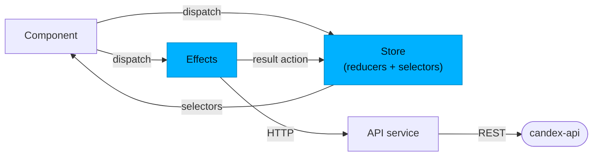

Candex has two Angular + Ionic front-ends that consume the same [Back-end](/en/back-end/): the **mobile app** users hold, and the **admin dashboard** that keeps the catalogue accurate. For the system around them, see [Architecture & Overview](/en/architecture/).

## Mobile app (`candex-app`)

Angular 20 + Ionic 8 + Capacitor 7, built with **standalone components** (no NgModules), feature-structured, with **NgRx** for state.

### Layers & their roles

| Layer | Folder | Role |
|-------|--------|------|
| **Pages** | `pages` | Routed screens: the auth flow, the `tabs` shell (home / dex / profile), drink details, and settings |
| **Components** | `components` | Reusable UI pieces shared across pages |
| **Services** | `services` | Side-effects & integrations: the API client (`api`), plus `auth`, `storage`, `theme`, `language`, `upload-care`, `haptics`, `native-app`, `dex-navigation` / `dex-ui`, `ui-alert`, and `app-initializer` |
| **Store** | `store` | NgRx state — one slice per domain (see below) |
| **Guards** | `guards` | Route protection (`auth`, `app`) — keep unauthenticated users out of protected screens |
| **Interceptors** | `interceptors` | `auth.interceptor` attaches the Firebase token to every API request |
| **Pipes** | `pipes` | View formatting — e.g. `dynamic-locale-date` for localized dates |

The principle mirrors the back-end: **components render and dispatch; services and the store do the work**. A component never calls the API directly.

### State with NgRx

State is split into slices — `app`, `auth`, `dex`, `drink`, `preferences`, `user` — each a complete NgRx unit (`actions`, `reducer`, `effects`, `selectors`, `state`). The flow is one-way:

A component **dispatches** an action; a **reducer** updates the slice purely, or an **effect** calls the API service and dispatches a result action; **selectors** feed the new state back to components. State persistence across launches is handled by `ngrx-store-localstorage` + Ionic Storage.

### Navigation

Routes are standalone: the **auth** flow (`welcome`, `register`, `login`, `complete-profile`, `verify-email`, `two-factor`), the **tabs** shell (`home`, `dex`, `profile`), `drink-details/:drinkId`, and **settings** (`account`, `preferences`, `about`).

### Cross-cutting concerns

- **Localization** — `ngx-translate` with a `language` service, and a `dynamic-locale-date` pipe for dates.
- **Theming** — a `theme` service drives light / dark.
- **Native** — Capacitor plugins (haptics, keyboard), a `native-app` service, and Firebase Authentication through Capacitor.
- **Media** — image upload via Uploadcare (`upload-care` service) and cropping via `ngx-image-cropper`.

## Admin dashboard (`candex-dashboard`)

Angular 20 + Ionic 8 + **Angular Material**, used to manage the catalogue. It is deliberately simpler than the app: **service-based state** (no NgRx), organised into `components`, `pages`, `services`, `interceptors`, and `interfaces`. An interceptor attaches the admin credentials to API calls, and it talks to the same REST API. Its SQL console is backed by the API's read-only role (see [Database & Model](/en/database/#read-only-sql-console)).

## Where to go next

- Look & feel, components, tokens → **UI/UX (+ Design System)** *(planned)*
- The API the front-ends consume → [Back-end](/en/back-end/)
- The big picture → [Architecture & Overview](/en/architecture/)
