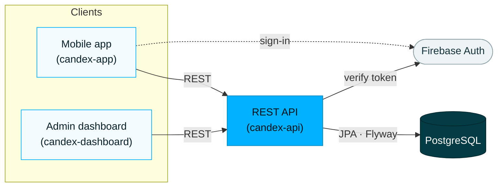

This page orients you if you are going to work on Candex. For the product itself — what it is and how it feels to use — start with [Understanding Candex](/en/getting-started/).

## The system at a glance

Candex is not one app but a few pieces working together. Users touch the **mobile app**. An **admin dashboard** keeps the drink catalogue accurate. Both talk to a single **REST API**, which holds the domain and stores everything in **PostgreSQL**. Sign-in is handled by **Firebase**.

## Repositories

| Repository | Role | Status |
|------------|------|--------|
| `candex-app` | Mobile client (Angular + Ionic + Capacitor) | Active |
| `candex-dashboard` | Admin dashboard for managing the catalogue | Active |
| `candex-api` | REST API and domain model, backed by PostgreSQL | Active |
| `candex-handbook` | This documentation site (Astro Starlight) | Active |
| `candex-crawler` | Crawler that gathers drink and catalogue data | Active |
| `candex-ai` | AI module (Python) | Early / placeholder |
| `candex-backups` | Firestore backup tooling | Deprecated — predates the move to PostgreSQL |
| `candex-api-legacy` | Previous API (Node.js / Express) | Deprecated |

:::note
`candex-crawler` lives in its own repository (outside the main workspace); its role is summarised here from its purpose and will be detailed in its own handbook.
:::

## Tech stack

**Mobile app** — `candex-app`

  <a class="tech-card" href="https://angular.dev" target="_blank" rel="noopener">Angularv20</a>
  <a class="tech-card" href="https://ionicframework.com" target="_blank" rel="noopener">Ionicv8</a>
  <a class="tech-card" href="https://capacitorjs.com" target="_blank" rel="noopener">Capacitorv7</a>
  <a class="tech-card" href="https://www.typescriptlang.org" target="_blank" rel="noopener">TypeScript</a>
  <a class="tech-card" href="https://ngrx.io" target="_blank" rel="noopener">NgRxStore · Effects · Entity</a>
  <a class="tech-card" href="https://rxjs.dev" target="_blank" rel="noopener">RxJS</a>
  <a class="tech-card" href="https://firebase.google.com/products/auth" target="_blank" rel="noopener">FirebaseAuth</a>

**Admin dashboard** — `candex-dashboard`

  <a class="tech-card" href="https://angular.dev" target="_blank" rel="noopener">Angularv20</a>
  <a class="tech-card" href="https://ionicframework.com" target="_blank" rel="noopener">Ionicv8</a>
  <a class="tech-card" href="https://www.typescriptlang.org" target="_blank" rel="noopener">TypeScript</a>
  <a class="tech-card" href="https://material.angular.io" target="_blank" rel="noopener">MatAngular Material</a>
  <a class="tech-card" href="https://firebase.google.com/products/auth" target="_blank" rel="noopener">FirebaseAuth</a>

**Back-end** — `candex-api`

  <a class="tech-card" href="https://spring.io/projects/spring-boot" target="_blank" rel="noopener">Spring Bootv3.5</a>
  <a class="tech-card" href="https://openjdk.org" target="_blank" rel="noopener">Java21</a>
  <a class="tech-card" href="https://maven.apache.org" target="_blank" rel="noopener">Mavenbuild (wrapper)</a>
  <a class="tech-card" href="https://www.postgresql.org" target="_blank" rel="noopener">PostgreSQL</a>
  <a class="tech-card" href="https://www.red-gate.com/products/flyway/" target="_blank" rel="noopener">Flywaymigrations</a>
  <a class="tech-card" href="https://mapstruct.org" target="_blank" rel="noopener">MsMapStructmapping</a>
  <a class="tech-card" href="https://spring.io/projects/spring-security" target="_blank" rel="noopener">Spring SecurityOAuth2</a>
  <a class="tech-card" href="https://swagger.io" target="_blank" rel="noopener">OpenAPIspringdoc</a>

**Quality & delivery**

  <a class="tech-card" href="https://www.docker.com" target="_blank" rel="noopener">DockerCompose</a>
  <a class="tech-card" href="https://junit.org" target="_blank" rel="noopener">JUnit+ Mockito</a>
  <a class="tech-card" href="https://testcontainers.com" target="_blank" rel="noopener">TcTestcontainers</a>
  <a class="tech-card" href="https://www.jacoco.org/jacoco/" target="_blank" rel="noopener">JcJaCoCocoverage</a>
  <a class="tech-card" href="https://eslint.org" target="_blank" rel="noopener">ESLint</a>
  <a class="tech-card" href="https://prettier.io" target="_blank" rel="noopener">Prettier</a>
  <a class="tech-card" href="https://www.cypress.io" target="_blank" rel="noopener">Cypresse2e</a>

## Where things live

- **Domain & API** — `candex-api`. Entities and business rules in `src/main/java`; schema in PostgreSQL, evolved through Flyway migrations under `src/main/resources/db/migration`.
- **Mobile UI** — `candex-app` (Angular + Ionic, NgRx for state).
- **Admin UI** — `candex-dashboard` (Angular + Ionic + Angular Material).

The codebase is the source of truth: when documentation and code disagree, the code wins and the docs are corrected.

## Running it locally

Candex runs as three apps — the mobile app and the dashboard (Ionic/Angular, run with npm) and the API (Maven + Spring Boot, with PostgreSQL), each in three environments (local, dev, prod). The full setup — prerequisites, cloning, environment files, the database, and the per-app commands — lives in the **[Local Installation](/en/local-installation/)** handbook.

## Where to go next

- Set up your machine → [Local Installation](/en/local-installation/)
- Understand how the pieces fit, and why → [Architecture & Overview](/en/architecture/)
- The precise domain language → Glossary / Domain *(planned)*

**Your first step:** clone the repositories, then follow [Local Installation](/en/local-installation/) to get the API and at least one front-end running against a local database.
