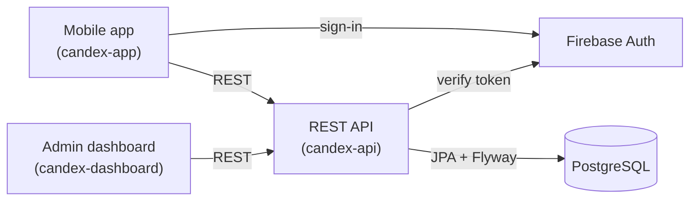

Start here. By the end of this page you will know what Candex is, how it works for the people who use it, what the project is made of, and where to go next. Later handbooks go deep on each area — this one gives you the whole picture.

## What Candex is

Candex is a mobile app that turns **discovering and collecting drinks into a game**. You explore beverages from around the world, mark the ones you have tried or own, and fill in a personal catalogue — your **World Dex** — the way you would complete a collection in a video game.

The idea is simple: make discovering drinks feel like collecting. Every drink you unlock lights up in your Dex, your progress is visible, and there is always something new to find.

Candex is built around a few kinds of people:

- **Explorers** — who want to discover local, rare, or popular drinks from elsewhere.
- **Collectors** — who want to complete their World Dex and chase what they are missing.
- **Sharers** — who love to show off a good find.

What you can do in the app:

- **Discover** drinks from around the world
- **Unlock** the ones you have tried or own
- **Watch your World Dex fill up** as your collection grows
- **Browse** by brand, series, and flavour
- **Make it yours** with a personal profile

## How it works

The experience is a simple loop:

1. **Discover** — browse the catalogue of drinks, organised by brand, series, and flavour.
2. **Unlock** — mark a drink as collected. It lights up in your World Dex.
3. **Progress** — your World Dex fills in as you go, and you can see how far along you are.

Everything else — profiles, syncing, the admin side that keeps the catalogue accurate — exists to support that loop.

## Core concepts

A few words show up throughout Candex and the rest of this documentation. Here they are in plain terms; the planned **Glossary / Domain** handbook defines each one precisely against the data model.

| Term | What it means |
|------|---------------|
| Drink | A beverage in the catalogue — the thing you collect. |
| Can | A physical can or packaging of a drink (a drink can have several). |
| Brand | The company that makes a drink (for example Monster or Coca-Cola). |
| Series | A line or range within a brand (for example Monster Ultra). |
| Flavour | A drink's flavour, translated per language. |
| World Dex | Your global collection catalogue — what you are filling in. |
| Unlock | Marking a drink as collected, so it counts toward your Dex. |

:::note
Some older product notes mention ideas like *intake* or *wishlist*. These are not part of the app today, so they are left out here and will be documented if they are built.
:::

## The system behind it

Candex is not one app but a few pieces working together. Users touch the **mobile app**. An **admin dashboard** keeps the drink catalogue accurate. Both talk to a single **REST API**, which holds the domain and stores everything in **PostgreSQL**. Sign-in is handled by **Firebase**.

The workspace holds six repositories. Three are the live system above; the others are either superseded or early.

| Repository | Role | Status |
|------------|------|--------|
| `candex-app` | Mobile client (Angular + Ionic + Capacitor) | Active |
| `candex-dashboard` | Admin dashboard for managing the catalogue | Active |
| `candex-api` | REST API and domain model, backed by PostgreSQL | Active |
| `candex-backups` | Firestore backup tooling | Deprecated — predates the move to PostgreSQL |
| `candex-api-legacy` | Previous API (Node.js / Express) | Deprecated |
| `candex-ai` | AI module (Python) | Early / placeholder |

The **Architecture & Overview** handbook (planned) goes into how these fit together and why.

## Tech stack

**Front-end** — the mobile app and the admin dashboard

  <a class="tech-card" href="https://angular.dev" target="_blank" rel="noopener">Angularv20</a>
  <a class="tech-card" href="https://ionicframework.com" target="_blank" rel="noopener">Ionicv8</a>
  <a class="tech-card" href="https://capacitorjs.com" target="_blank" rel="noopener">Capacitorv7</a>
  <a class="tech-card" href="https://www.typescriptlang.org" target="_blank" rel="noopener">TypeScript</a>
  <a class="tech-card" href="https://ngrx.io" target="_blank" rel="noopener">NgNgRxStore · Effects · Entity</a>
  <a class="tech-card" href="https://rxjs.dev" target="_blank" rel="noopener">RxJS</a>
  <a class="tech-card" href="https://material.angular.io" target="_blank" rel="noopener">MatAngular Materialdashboard</a>
  <a class="tech-card" href="https://firebase.google.com/products/auth" target="_blank" rel="noopener">FirebaseAuth</a>

**Back-end** — the REST API

  <a class="tech-card" href="https://spring.io/projects/spring-boot" target="_blank" rel="noopener">Spring Bootv3.5</a>
  <a class="tech-card" href="https://openjdk.org" target="_blank" rel="noopener">Java21</a>
  <a class="tech-card" href="https://maven.apache.org" target="_blank" rel="noopener">MvnMavenbuild (wrapper)</a>
  <a class="tech-card" href="https://www.postgresql.org" target="_blank" rel="noopener">PostgreSQL</a>
  <a class="tech-card" href="https://www.red-gate.com/products/flyway/" target="_blank" rel="noopener">FwFlywaymigrations</a>
  <a class="tech-card" href="https://mapstruct.org" target="_blank" rel="noopener">MsMapStructmapping</a>
  <a class="tech-card" href="https://spring.io/projects/spring-security" target="_blank" rel="noopener">OA2Spring SecurityOAuth2</a>
  <a class="tech-card" href="https://swagger.io" target="_blank" rel="noopener">OpenAPIspringdoc</a>

**Quality & delivery**

  <a class="tech-card" href="https://www.docker.com" target="_blank" rel="noopener">DockerCompose</a>
  <a class="tech-card" href="https://junit.org" target="_blank" rel="noopener">JUJUnit+ Mockito</a>
  <a class="tech-card" href="https://testcontainers.com" target="_blank" rel="noopener">TcTestcontainers</a>
  <a class="tech-card" href="https://www.jacoco.org/jacoco/" target="_blank" rel="noopener">JcJaCoCocoverage</a>
  <a class="tech-card" href="https://eslint.org" target="_blank" rel="noopener">ESLint</a>
  <a class="tech-card" href="https://www.cypress.io" target="_blank" rel="noopener">Cypresse2e</a>

## Running Candex locally

Candex runs as three apps: the **mobile app** and the **dashboard** (both Ionic/Angular, run with npm) and the **API** (Maven + Spring Boot, with a PostgreSQL database). Each runs in three environments — local, dev, and prod.

Setting it up end to end — prerequisites, cloning, environment files, the database, and the per-app, per-environment commands — is a guide in its own right. It lives in the **Local Installation** handbook (planned), so this page does not duplicate it.

## Where to go next

The documentation is a set of focused handbooks. English is the canonical language; a French version is available from the language selector. Every page supports System / Light / Dark themes, full-text search, and a per-handbook PDF export.

**Available now**

- Getting Started — this handbook.

**Planned**

- Architecture & Overview · Glossary / Domain · Product · UI/UX (+ Design System) · Front-end · Back-end · API / Contracts · Database / Model · Local Installation · Software Quality · Testing · Deployment · Backups · Security

Planned handbooks are listed so you can see the full scope; they are linked here as each one is written.
