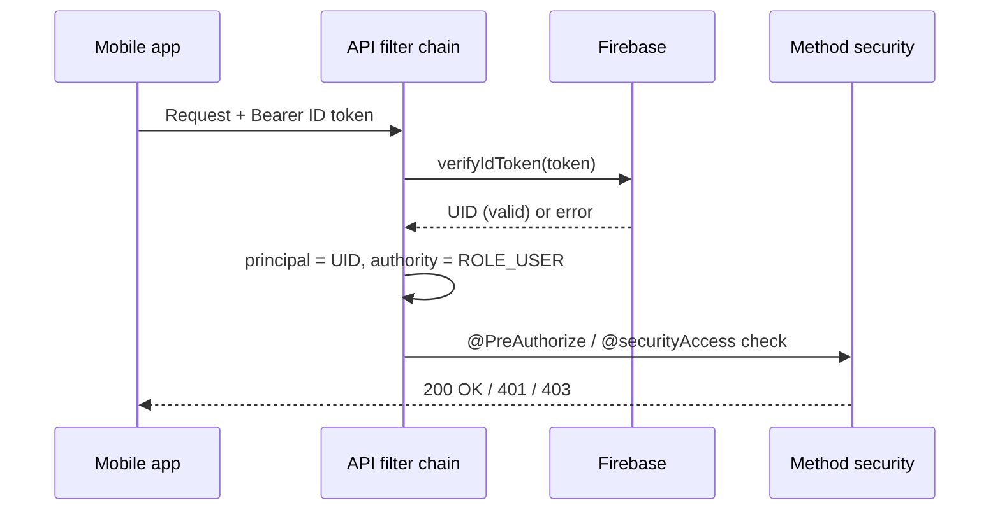
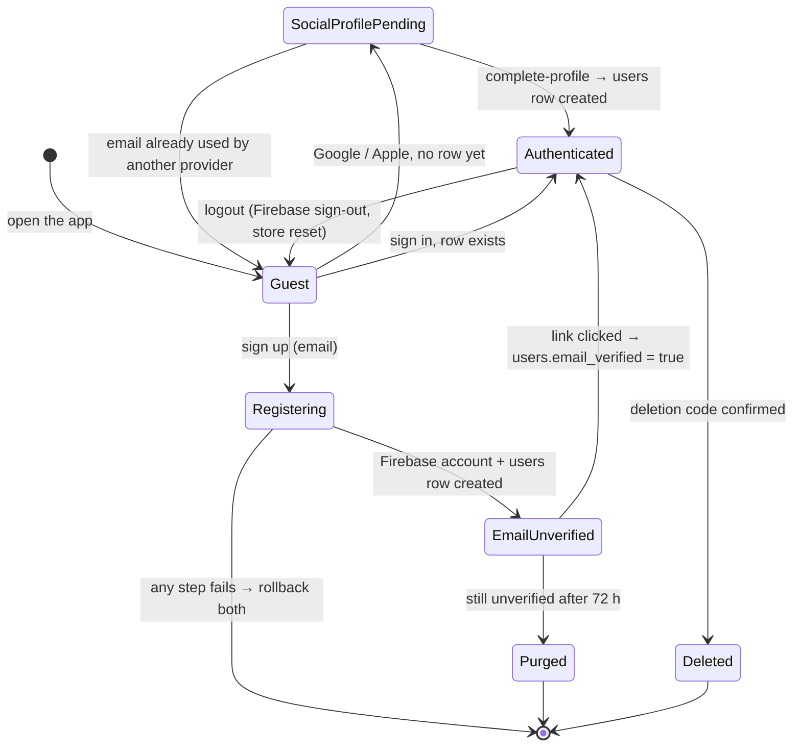
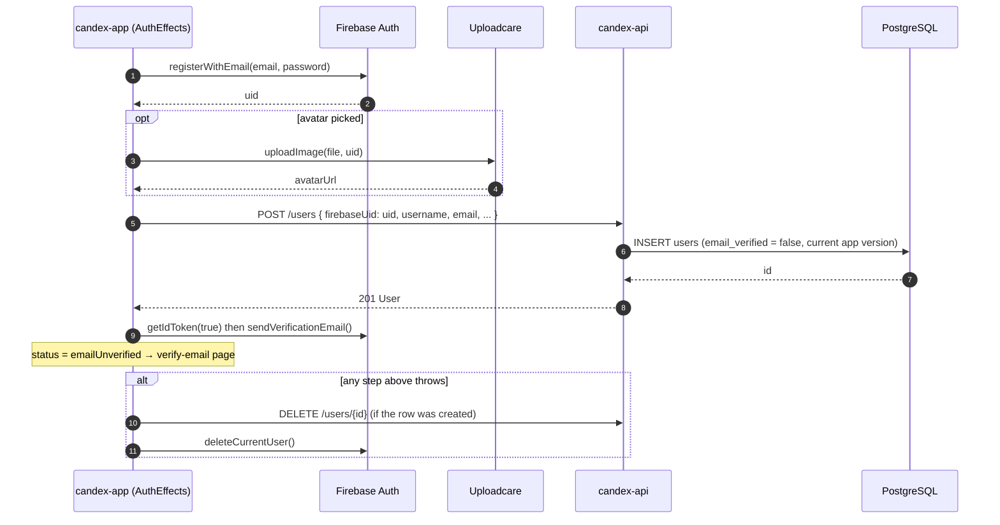
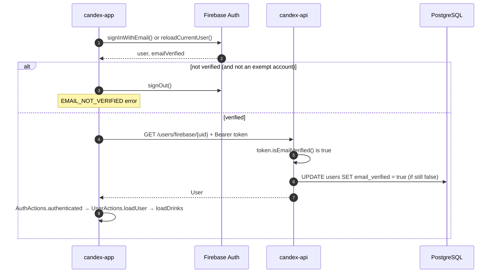

Security is enforced in the **API**. Authentication decides *who* is calling; authorization decides *what* they may do. The HTTP layer stays deliberately thin — it sets the authentication mechanism and a few public routes — while the real business rules live in method security, next to the endpoints they protect.

## Request authentication at a glance



## Authentication

Two mechanisms coexist.

**Firebase ID tokens** are the primary path, for app users. A request carries `Authorization: Bearer <token>`; the `FirebaseAuthenticationFilter` verifies it (`FirebaseAuth.verifyIdToken`) and, on success, sets a Spring Security authentication whose **principal is the Firebase UID** and whose authority is `ROLE_USER`. Verification is non-blocking: if the token is missing, invalid, expired, or revoked, the filter simply clears the context and lets authorization reject the request downstream. Firebase is the source of truth for app identity.

The whole filter fits in a few lines — note that it never rejects a request itself:

```java
// FirebaseAuthenticationFilter (a OncePerRequestFilter)
String authorization = request.getHeader("Authorization");

if (authorization != null && authorization.startsWith("Bearer ")) {
    try {
        Authentication authentication =
                firebaseAuthenticationService.authenticate(authorization.substring(7));

        if (authentication != null) {
            SecurityContextHolder.getContext().setAuthentication(authentication);
        }
    } catch (FirebaseAuthException exception) {
        SecurityContextHolder.clearContext(); // invalid token = anonymous, not an error here
    }
}

filterChain.doFilter(request, response); // @PreAuthorize decides later
```

**Interim HTTP Basic Auth** covers the administrator. An in-memory user store (`InMemoryUserDetailsManager`) holds two accounts loaded from environment variables — a standard `user` (`ROLE_USER`) and an `admin` (`ROLE_ADMIN`) — with BCrypt-hashed passwords. The code documents this as a temporary bridge, intended to be replaced by JWT-based authentication later.

The filter chain is **stateless** (`SessionCreationPolicy.STATELESS`), **CSRF is disabled** (there are no server sessions or cookies to protect), and **CORS** is handled by a dedicated `CorsFilter` with a fixed allow-list of origins (`CorsOrigins`).

## Roles

There are two authorities — `ROLE_USER` and `ROLE_ADMIN` (`SecurityRoles`).

## Authorization

Authorization runs in two layers.

**At the HTTP layer** (`SecurityConfig`), only a handful of rules are declared:

- **Public** — `/error`, `/actuator/health`, user registration (`POST /users`), and the existence check (`GET /users/exists`).
- **Admin only** — Swagger UI and the OpenAPI docs (`/swagger-ui/**`, `/v3/api-docs/**`) and the actuator (`/actuator/**`).
- **Everything else** — authenticated.

**At the method layer** (`@EnableMethodSecurity`), each endpoint carries a `@PreAuthorize` rule, built from reusable `SecurityExpressions`:

- `USER_OR_ADMIN` — any authenticated user or admin.
- `ADMIN_ONLY` — admin authority required (catalogue writes, imports, admin operations).
- `PERMIT_ALL` — explicitly open.

Ownership-scoped endpoints go through the `@securityAccess` bean (`SecurityAccess`) rather than a role alone, e.g. `@PreAuthorize("@securityAccess.canAccessUserId(authentication, #id)")`. The rule is consistent: an **admin bypasses ownership**, otherwise the caller's Firebase UID (or user id) must match the resource's owner. The same bean also guards Firebase-UID access (`canAccessFirebaseUid`) and unlocked-drink management (`canManageUserUnlockedDrink`).

In code, a route states its rule in one annotation, and the ownership check is a plain Java method on the bean:

```java
@GetMapping("/{id}")
@PreAuthorize("@securityAccess.canAccessUserId(authentication, #id)")
public ResponseEntity<Result<User>> getUserById(@PathVariable Integer id) { ... }
```

```java
// SecurityAccess
public boolean canAccessUserId(Authentication authentication, Integer userId) {
    if (authentication == null || !authentication.isAuthenticated() || userId == null) {
        return false;
    }

    if (hasAuthority(authentication)) { // ROLE_ADMIN
        return true;
    }

    // The principal's name is the Firebase UID set by the filter.
    return Objects.equals(
            userService.getFirebaseUidByUserId(userId),
            authentication.getName()
    );
}
```

`#id` refers to the method parameter of the same name, so the check runs with the value from the URL before the controller body executes.

## User lifecycle

An app user exists **twice**: as a **Firebase account** (identity, password, providers, email verification) and as a **`users` row in PostgreSQL** (profile, collection, role in the domain). The two are linked by `users.firebase_uid`. Every step of the lifecycle has to keep them in sync — the app orchestrates creation (`AuthEffects`), the API orchestrates deletion (`UserService`, `UnverifiedUserCleanupJob`).



| State | Firebase account | `users` row | App `AuthStatus` |
|-------|------------------|-------------|------------------|
| Guest | — | — | `guest` / `anonymous` |
| Registering | being created | being created | `registering` |
| EmailUnverified | exists, `emailVerified = false` | exists, `email_verified = false` | `emailUnverified` |
| SocialProfilePending | exists (provider) | — | `socialProfilePending` |
| Authenticated | exists, verified | exists | `authenticated` |
| Purged / Deleted | deleted | deleted | back to `anonymous` |

### Registration (email & password)

The app creates both sides and **rolls both back** if anything fails, so neither an orphan Firebase account nor an orphan row survives a failed sign-up.



### Verification, sign-in and the `email_verified` flag

Firebase owns verification; PostgreSQL keeps a **copy** (shown on the dashboard and read by the cleanup job). The copy is synced lazily: whenever the app calls `GET /users/firebase/{uid}` with a token whose `email_verified` claim is true, `UserService.getUserByFirebaseUid` flips the row to `true`.



Social sign-in (Google / Apple) follows the same `GET /users/firebase/{uid}` call: a `200` signs the user in; a `404` means "first time" — unless `GET /users/exists?field=email` says the email is already registered with another provider, in which case the app signs out with `ACCOUNT_EXISTS_DIFFERENT_PROVIDER` instead of creating a duplicate.

### Deletion

Both deletion paths delete the **row first, then the Firebase account**, inside one transaction: if Firebase fails (other than "user not found"), the exception rolls the row back, so the two never drift apart. The Uploadcare avatar is removed last, best-effort.

- **By the user** — `POST /users/me/deletion-code` emails a 6-digit code (hashed in `account_deletion_code`, valid 1 h, 5 attempts, 1 resend per minute); `DELETE /users/me` with that code calls `UserService.deleteUserById`.
- **By the cleanup job** — `UnverifiedUserCleanupJob` runs daily at 03:30 and looks for rows still `email_verified = false` after 72 h (`candex.security.unverified-user-retention`). For each, it asks Firebase first: if the user did verify, the stale flag is re-synced and the account kept; otherwise both sides are deleted. Accounts listed in `candex.security.cleanup-protected-emails` are skipped.
- **By an admin** — `DELETE /users/{id}` (`canDeleteUserId`), same `deleteUserById` path.

## Secrets

No credential or key is committed. The Firebase service account is loaded at runtime from a configured file path (`candex.firebase.config-path`), never from the repository. The Basic-auth accounts (`candex.security.*`) and the database credentials come from environment variables, per Spring profile — the repositories ship only `.env.example` files with placeholders. See [Local Installation](/en/local-installation/) for setting them locally and [Deployment](/en/deployment/) for the deployed environments.

## On the client side

The mobile app signs users in with **Firebase Authentication** and calls the API with the resulting ID token in the `Authorization` header; the API trusts Firebase to have authenticated the user and derives identity from the verified token. See [Architecture](/en/architecture/) for how the pieces connect.

## Where to go next

- The endpoints these rules protect → [API / Contracts](/en/api-contracts/)
- The layers behind them → [Back-end](/en/back-end/)
- The big picture → [Architecture](/en/architecture/)
