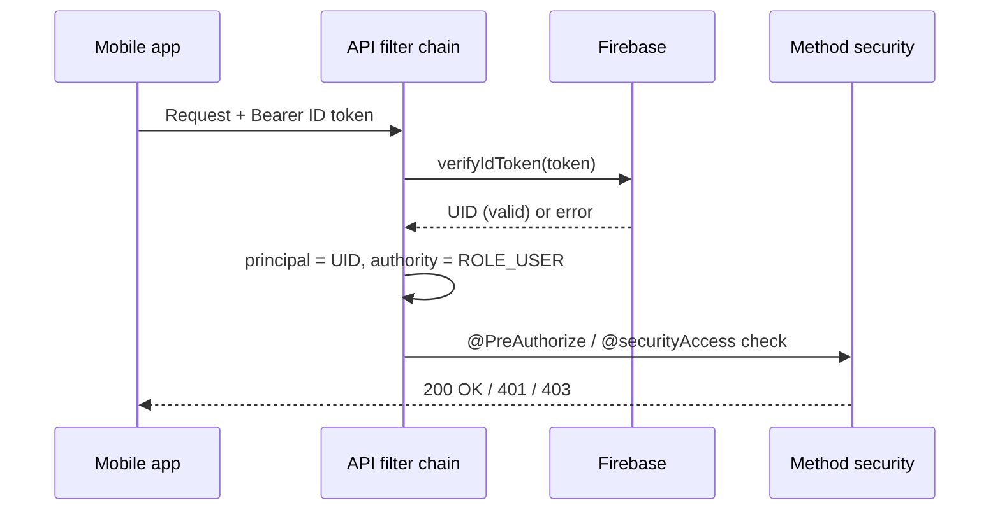

Security is enforced in the **API**. Authentication decides *who* is calling; authorization decides *what* they may do. The HTTP layer stays deliberately thin — it sets the authentication mechanism and a few public routes — while the real business rules live in method security, next to the endpoints they protect.

## Request authentication at a glance

## Authentication

Two mechanisms coexist.

**Firebase ID tokens** are the primary path, for app users. A request carries `Authorization: Bearer <token>`; the `FirebaseAuthenticationFilter` verifies it (`FirebaseAuth.verifyIdToken`) and, on success, sets a Spring Security authentication whose **principal is the Firebase UID** and whose authority is `ROLE_USER`. Verification is non-blocking: if the token is missing, invalid, expired, or revoked, the filter simply clears the context and lets authorization reject the request downstream. Firebase is the source of truth for app identity.

**Interim HTTP Basic Auth** covers the administrator. An in-memory user store (`InMemoryUserDetailsManager`) holds two accounts loaded from environment variables — a standard `user` (`ROLE_USER`) and an `admin` (`ROLE_ADMIN`) — with BCrypt-hashed passwords. The code documents this as a temporary bridge, intended to be replaced by JWT-based authentication later.

The filter chain is **stateless** (`SessionCreationPolicy.STATELESS`), **CSRF is disabled** (there are no server sessions or cookies to protect), and **CORS** is handled by a dedicated `CorsFilter` with a fixed allow-list of origins (`CorsOrigins`).

## Roles

There are two authorities — `ROLE_USER` and `ROLE_ADMIN` (`SecurityRoles`).

## Authorization

Authorization runs in two layers.

**At the HTTP layer** (`SecurityConfig`), only a handful of rules are declared:

- **Public** — `/error`, `/actuator/health`, user registration (`POST /users`), and the existence check (`GET /users/exists`).
- **Admin only** — Swagger UI and the OpenAPI docs (`/swagger-ui/**`, `/v3/api-docs/**`) and the actuator (`/actuator/**`).
- **Everything else** — authenticated.

**At the method layer** (`@EnableMethodSecurity`), each endpoint carries a `@PreAuthorize` rule, built from reusable `SecurityExpressions`:

- `USER_OR_ADMIN` — any authenticated user or admin.
- `ADMIN_ONLY` — admin authority required (catalogue writes, imports, admin operations).
- `PERMIT_ALL` — explicitly open.

Ownership-scoped endpoints go through the `@securityAccess` bean (`SecurityAccess`) rather than a role alone, e.g. `@PreAuthorize("@securityAccess.canAccessUserId(authentication, #id)")`. The rule is consistent: an **admin bypasses ownership**, otherwise the caller's Firebase UID (or user id) must match the resource's owner. The same bean also guards Firebase-UID access (`canAccessFirebaseUid`) and unlocked-drink management (`canManageUserUnlockedDrink`).

## Secrets

No credential or key is committed. The Firebase service account is loaded at runtime from a configured file path (`candex.firebase.config-path`), never from the repository. The Basic-auth accounts (`candex.security.*`) and the database credentials come from environment variables, per Spring profile — the repositories ship only `.env.example` files with placeholders. See [Local Installation](/en/local-installation/) for setting them locally and [Deployment](/en/deployment/) for the deployed environments.

## On the client side

The mobile app signs users in with **Firebase Authentication** and calls the API with the resulting ID token in the `Authorization` header; the API trusts Firebase to have authenticated the user and derives identity from the verified token. See [Architecture](/en/architecture/) for how the pieces connect.

## Where to go next

- The endpoints these rules protect → [API / Contracts](/en/api-contracts/)
- The layers behind them → [Back-end](/en/back-end/)
- The big picture → [Architecture](/en/architecture/)
