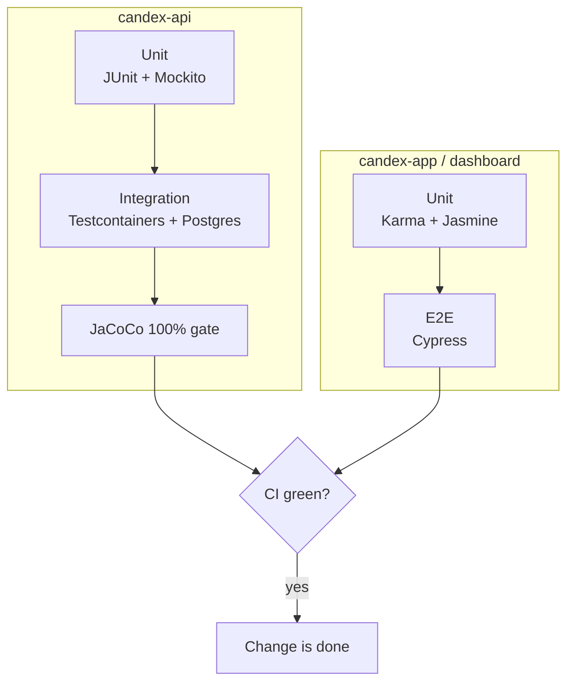

Testing runs across the whole stack and is enforced in CI. For how the code is organised, see [Back-end](/en/back-end/) and [Front-end](/en/front-end/).

## The test setup at a glance



## Back-end (`candex-api`)

The API has around **90 test classes** on two levels:

- **Unit tests** — **JUnit 5** with **Mockito** for isolated logic.
- **Integration tests** — **Testcontainers** spins up a real **PostgreSQL** container, so tests run against the actual database rather than a mock.

Coverage is a hard gate: **JaCoCo** enforces **100%** at the bundle level (line and branch) — the build fails below the threshold. **Checkstyle** enforces the code style.

```bash
./mvnw test        # run the tests
./mvnw verify      # tests + JaCoCo coverage gate + Checkstyle
```

## Front-ends (`candex-app`, `candex-dashboard`)

Both Angular apps use **Karma + Jasmine** for unit tests, run headless with coverage. Specs live next to the code (`*.spec.ts`) — roughly **80** in the app and **40** in the dashboard. The mobile app also has **Cypress** for end-to-end tests.

```bash
npm run test       # watch mode, with coverage
npm run test:ci    # headless (ChromeHeadless), single run, with coverage
```

## Continuous integration

Every push and pull request runs a **quality gate** (`.github/workflows/ci.yml`) per repository:

| Repository | What CI runs |
|------------|--------------|
| `candex-api` | `mvn clean verify checkstyle:checkstyle` (tests + 100% JaCoCo gate + Checkstyle), then a Docker image build; uploads the Checkstyle and JaCoCo reports |
| `candex-app` · `candex-dashboard` | `ng test` headless with coverage, plus lint |

**Qodana** adds static code-quality analysis on top.

## Conventions

Tests mirror the code they cover, at every level:

- **One unit per file** — a test class (API) or top-level `describe` (front) per class or service, named after it: `@DisplayName("ColorMatcher")`, `describe('SettingsActionsService')`.
- **One method per group** — each method under test gets its own `@Nested` class on the API (`@DisplayName("findNearestAnchor()")`) or a nested `describe('refreshProviderState()')` on the front.
- **One case per test** — a single `@Test` / `it` per scenario, each named as the behaviour it asserts (*"should return semantic match when a ColorGroup zone matches"*, *"dispatches linkGoogle when not yet linked"*). On the API every level carries a `@DisplayName`, so the test report reads as sentences.
- **A smoke test per file** — `contextLoads()` (*"should load correctly"*) on the API, `it('should be created')` on the front, so a wiring or injection failure surfaces first.
- **Shared fixtures, not re-created objects** — reusable test data lives in one place and is imported, never rebuilt in each file: the API's `util/test/fixture` package (`TestApp`, `TestEntity`, `TestGetDTO`, `TestPostDTO` — final classes exposing fixed constants like `FIXED_NOW` and canned entities/DTOs), and the front-ends' `utils/tests/mocks.ts` and test helpers (dashboard: `tests/mocks`).

And across the stack:

- Tests live **beside the code** they cover (`*.spec.ts`; `*Test` on the API).
- Integration tests use **Testcontainers**, not mocks, so they exercise real SQL and migrations.
- The API's **100% coverage** gate means new code ships with its tests — and a change is not done until CI is green.

## Where to go next

- Code style, conventions, static analysis → [Software Quality](/en/software-quality/)
- The API → [Back-end](/en/back-end/) · The front-ends → [Front-end](/en/front-end/)
