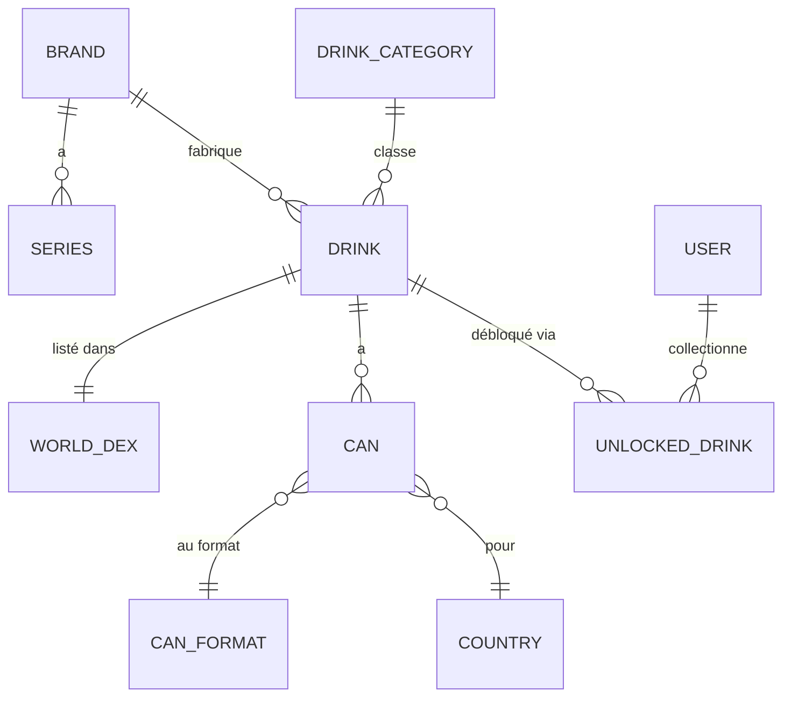
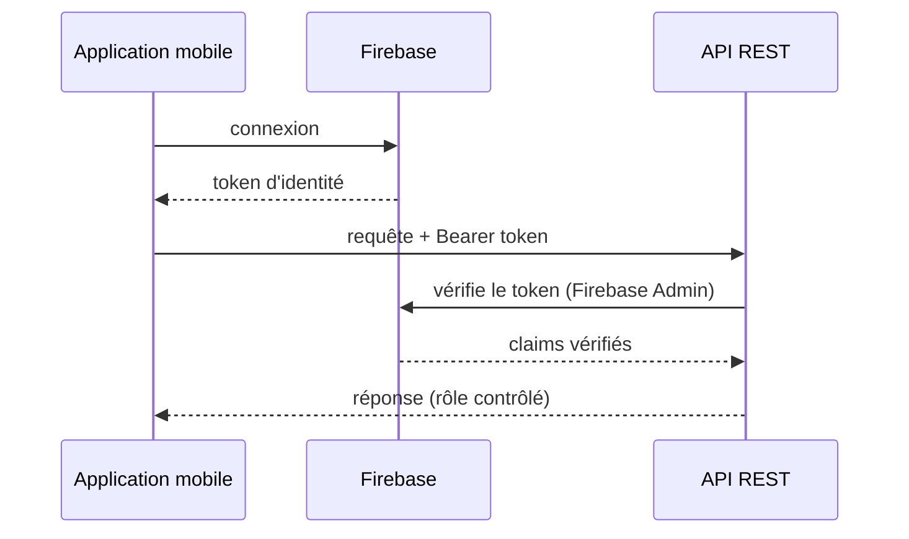

Voici la carte de la construction de Candex. Elle reste haut-niveau et renvoie ailleurs : les handbooks **Back-end**, **Front-end**, **Base de données** et **Déploiement** approfondissent chaque domaine. Pour les briques et les dépôts, voir [Travailler sur Candex](/fr/getting-started-dev/).

## Modèle de domaine

Le catalogue est un graphe d'entités autour de **Drink**. Une boisson appartient à une **marque** et à une **catégorie**, est listée une fois dans le **World Dex**, et possède une ou plusieurs **canettes** (par pays, format et couleurs). Les utilisateurs construisent leur collection en **débloquant** des boissons.

Autour de ce cœur gravitent des entités de support — `Flavor` (avec catégories et traductions), `Color`, `Language`, `DrinkLocalization`, et `WorldDexArrival` / `WorldDexHistory` pour l'ordonnancement. Les entités de catalogue (`Brand`, `Series`, `Flavor`, `CanFormat`) portent un lien **`introduced_in_version`** vers `AppVersion` : le catalogue est donc versionné avec l'app. Le modèle complet est dans le handbook **[Base de données & Modèle](/fr/database/)**.

## Architecture de l'API

`candex-api` est une application Spring Boot en couches, sous `dev.ruster.candex` :

| Couche | Package | Responsabilité |
|--------|---------|----------------|
| Web | `controller` | Endpoints REST |
| Contrat | `dto` (`request` / `response`), `mapper` | Formes de l'API, mappées vers/depuis les entités avec MapStruct |
| Métier | `service` (`core`, `analysis`) | Logique de domaine |
| Données | `repository`, `entity` | Spring Data JPA sur PostgreSQL |
| Transverse | `security`, `exception`, `validation`, `config`, `job` | Auth, erreurs, validation, config, tâches planifiées |

La frontière `dto` + `mapper` découple le contrat de l'API du modèle JPA — les contrôleurs n'exposent jamais les entités directement.

## Authentification & sécurité

L'app se connecte via **Firebase** ; l'API vérifie le token Firebase à chaque requête (`FirebaseAuthenticationFilter` / `FirebaseAuthenticationService`, via le SDK Firebase Admin) et autorise par rôle (`ROLE_ADMIN`, `ROLE_USER`).

## Données & migrations

Le domaine vit dans **PostgreSQL**. Le schéma est détenu par les migrations **Flyway** sous `candex-api/src/main/resources/db/migration` : chaque changement est un fichier versionné `V__*.sql`, et les données de seed (marques, versions d'app, etc.) sont aussi livrées en migrations — c'est pourquoi une base neuve est directement utilisable. Un rôle SQL en lecture seule est provisionné par migration pour une inspection sûre.

## Les front-ends

Les deux front-ends sont en Angular + Ionic et dialoguent avec la même API REST.

- **Application mobile** (`candex-app`) — état géré avec **NgRx**, organisé en slices : `auth`, `dex`, `drink`, `user`, `preferences`, `app`.
- **Tableau de bord admin** (`candex-dashboard`) — Angular + **Angular Material**, pour garder le catalogue à jour.

Voir le handbook **[Front-end](/fr/front-end/)** pour la structure et les conventions.

## Topologie de déploiement

Chaque environnement est une stack Docker Compose d'un conteneur **API** et d'un conteneur **PostgreSQL 17** :

| Environnement | Fichier compose | Notes |
|---------------|-----------------|-------|
| local | `compose.local.yaml` | Stack jetable via `scripts/candex.sh` (voir [Installation locale](/fr/local-installation/)) |
| dev | `compose.dev.yaml` | `api-dev` + `db-dev` ; API sur l'hôte `8081`, debug `5005` |
| prod | `compose.prod.yaml` | `api-prod` + `db-prod` |

:::note[À confirmer]
Le TLS et le reverse-proxy ne sont pas dans ces fichiers compose, bien qu'une variable `CADDY_EMAIL` existe — le point d'entrée public (probablement **Caddy**) semble donc géré au niveau serveur. Le handbook **[Déploiement](/fr/deployment/)** documente la topologie exacte.
:::

## Notes de conception

Groundé depuis le code et la config ; les points marqués *à confirmer* nécessitent ton apport.

- **API en couches avec frontière DTO/mapper** — les packages `dto` + `mapper` séparent le contrat public des entités JPA, pour que le modèle de données évolue sans casser les clients.
- **Firebase pour l'identité, PostgreSQL pour le domaine** — l'authentification est déléguée à Firebase tandis que toutes les données de catalogue et de collection sont relationnelles dans Postgres (visible depuis les dépendances et la config).
- **Schéma détenu par Flyway** — la base n'est jamais éditée à la main ; chaque changement est une migration versionnée, ce qui rend aussi l'install locale reproductible.
- **Tableau de bord séparé** — la gestion du catalogue est une app distincte de l'app mobile grand public. *(Rationale à confirmer.)*
- **Catalogue versionné** — les entités de catalogue référencent `AppVersion`. *(Usage visé à confirmer.)*

## Pour aller plus loin

- Le modèle de données → [Base de données](/fr/database/)
- Les couches de l'API → [Back-end](/fr/back-end/)
- Le front-end → [Front-end](/fr/front-end/)
