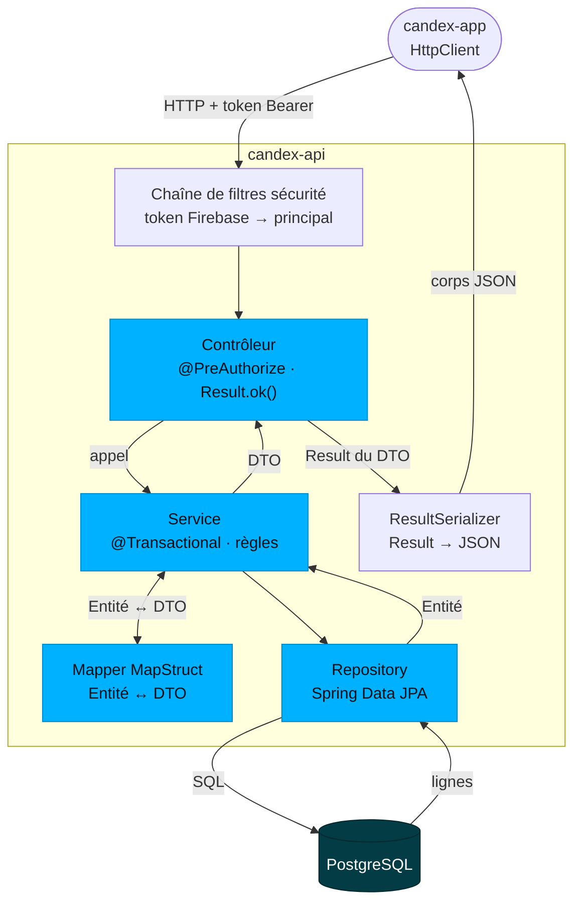
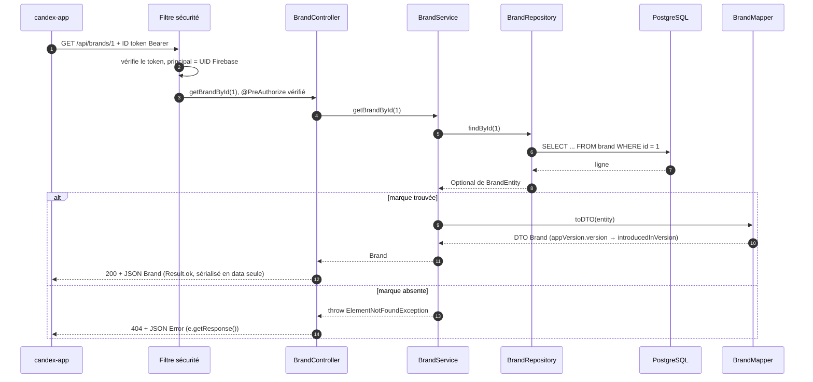

`candex-api` est une application Spring Boot en couches. Ce handbook couvre comment elle est construite ; pour le domaine qu'elle sert, voir [Base de données & Modèle](/fr/database/), et pour le système autour, [Architecture & Vue d'ensemble](/fr/architecture/).

## Flux d'une requête

Chaque requête traverse les mêmes couches. Les contrôleurs renvoient une enveloppe typée **`Result`** ; les services portent la logique ; les repositories sont du Spring Data JPA ; et la frontière entre entités JPA et formes de l'API est franchie par des mappers **MapStruct**.



### Une requête, de bout en bout

`GET /brands/{id}` tel qu'il s'exécute réellement — `BrandController` → `BrandService` → `BrandRepository` → `BrandMapper`. Toutes les lectures suivent ce schéma ; les écritures le parcourent à l'envers (DTO → `toEntity` → `save`).



Trois choses à retenir :

- **L'entité ne quitte jamais le service.** Le mapper tourne dans le service, le contrôleur ne voit que des DTO.
- **Les exceptions sont attrapées dans le contrôleur**, pas dans un `@ControllerAdvice` global : chaque endpoint liste les `CustomException` attendues et renvoie `e.getResponse()`. Une exception non attrapée tombe dans la gestion d'erreurs par défaut de Spring.
- **Les transactions vivent dans le service**, sur les chemins d'écriture (`@Transactional` sur `createUser`, les imports de `DrinkService`, …). Les lectures simples comme celle-ci n'en ont pas : les relations lazy sont résolues par le mapper grâce à l'*open-in-view* par défaut de Spring, qui garde la session JPA ouverte toute la requête.

### La même requête dans le code

Les trois classes derrière cette requête, sans leurs annotations Swagger. C'est le modèle que suit chaque ressource.

Le **contrôleur** déclare la route et la règle d'accès, délègue, et transforme le résultat en réponse — rien d'autre :

```java
@RestController
@RequiredArgsConstructor
@RequestMapping(ApiPaths.BRANDS)
@PreAuthorize(SecurityExpressions.USER_OR_ADMIN)
public class BrandController {

    private final BrandService brandService;

    @GetMapping("/{id}")
    public ResponseEntity<Result<Brand>> getBrandById(@PathVariable int id) {
        try {
            return Result.ok(brandService.getBrandById(id));
        } catch (ElementNotFoundException e) {
            return e.getResponse();
        }
    }
}
```

Le **service** lit via le repository, lève une exception typée quand une règle échoue, et renvoie un DTO — l'entité ne sort jamais :

```java
@Service
@RequiredArgsConstructor
public class BrandService {

    private final BrandRepository brandRepository;
    private final BrandMapper brandMapper;

    public Brand getBrandById(int id) {
        return brandMapper.toDTO(brandRepository.findById(id).orElseThrow(
                () -> new ElementNotFoundException(BrandEntity.class, "id", id)
        ));
    }
}
```

Le **mapper** est une interface : MapStruct génère l'implémentation à la compilation. Les champs de même nom se mappent seuls ; seules les différences sont déclarées :

```java
@Mapper(componentModel = "spring")
public interface BrandMapper {

    @Mapping(source = "appVersion.version", target = "introducedInVersion")
    Brand toDTO(BrandEntity entity);

    List<Brand> toDTO(List<BrandEntity> entityList);

    @Mapping(target = "id", ignore = true)
    @Mapping(target = "createdAt", ignore = true)
    @Mapping(target = "updatedAt", ignore = true)
    @Mapping(source = "introducedInVersion", target = "appVersion.version")
    BrandEntity toEntity(Brand dto);
}
```

Chaque couche a exactement un rôle :

| Couche | Responsabilité | Ne doit pas |
|--------|----------------|-------------|
| **Contrôleur** | Associer une requête HTTP à une méthode, contrôler l'accès (`@PreAuthorize`), renvoyer un `Result`. Mince. | Porter de la logique métier ni toucher la base |
| **Service** (`service/core`) | La logique métier : orchestration, transactions, vérification des règles, appel des repositories, mapping entités ↔ DTO, levée d'exceptions. | Connaître quoi que ce soit du HTTP |
| **Repository** | Accès Spring Data JPA à un agrégat — requêtes dérivées et personnalisées. | Porter des règles métier |
| **Entité** | Le modèle de domaine JPA (état persisté). | Franchir la frontière du service |
| **DTO** (`dto/request`, `dto/response`) | Les formes d'entrée et de sortie de l'API. | Porter des préoccupations de persistance |
| **Mapper** (MapStruct) | Convertir entités ↔ DTO à la frontière du service. | — |
| **Transverse** (`security`, `exception`, `validation`, `config`, `job`, `result`) | Auth, erreurs structurées, validation, configuration, jobs planifiés, enveloppe de réponse. | — |

La règle d'or : les entités n'atteignent jamais le contrôleur, et les contrôleurs ne portent jamais de logique.

## L'enveloppe de réponse

Chaque endpoint renvoie un `Result<T>` générique côté Java — mais **l'enveloppe n'est pas ce qui transite sur le réseau**. `ResultSerializer` la déballe : en cas de succès le corps est la `data` brute, en cas d'échec l'`Error` brute. Le statut HTTP fait office de drapeau.

`200` — `GET /brands/1` :

```json
{
  "id": 1,
  "name": "Monster Energy",
  "introducedInVersion": "1.0.0"
}
```

`404` — `GET /brands/999` :

```json
{
  "name": "ElementNotFoundException",
  "message": "BrandEntity not found for id = 999.",
  "status": 404,
  "timestamp": "2026-11-12 20:52:52"
}
```

- C'est pourquoi l'app type directement ses appels en `http.get<Brand>(...)` — il n'y a pas de `.data` à déballer.
- Les réponses de collection ajoutent un en-tête **`X-Total-Count`** ; les créations ajoutent un en-tête **`Location`**.

## Surface de l'API

Les chemins des ressources sont centralisés dans `ApiPaths` et exposés sous la base de l'API (par exemple `/api/drinks`). Environ **45 endpoints** répartis sur ~14 ressources (28 `GET`, 9 `POST`, 4 `DELETE`, 3 `PUT`, 1 `PATCH`) :

| Ressource | Chemin |
|-----------|--------|
| Drinks | `/drinks` (dont import en masse `import`, `import/diff`, `import/sync`) |
| Cans · Can formats | `/cans` · `/can-formats` |
| Brands | `/brands` |
| Flavors · Flavor categories | `/flavors` · `/flavor-categories` |
| Colors · Drink categories | `/colors` · `/drink-categories` |
| World Dex | `/world-dex` |
| Users · Unlocked drinks | `/users` · `/user-unlocked-drinks` |
| App versions · Reports | `/app-versions` · `/reports` |
| Console SQL admin | `/admin/...` |

La doc interactive est sur **Swagger UI** (`/swagger-ui.html`). Les contrats exacts requête/réponse relèvent du handbook **[API / Contrats](/fr/api-contracts/)**.

## Autorisation

Les endpoints sont gardés par `@PreAuthorize` et `SecurityExpressions` :

| Règle | Pour |
|-------|------|
| `USER_OR_ADMIN` | Lectures authentifiées (catalogue, World Dex) |
| `ADMIN_ONLY` | Écritures du catalogue et opérations admin |
| `PERMIT_ALL` | Les rares endpoints publics |
| `@securityAccess.canAccessUserId(...)` | Données propres à l'utilisateur — chacun ne touche que ses propres enregistrements |

L'identité vient de Firebase (voir [Architecture & Vue d'ensemble](/fr/architecture/#authentification--sécurité)).

## Services & logique métier

La logique métier est dans `service/core` — un service par ressource (`DrinkService`, `BrandService`, `WorldDexService`, `UserService`, …) — plus des services de support : `ImageService` (analyse), `UploaderService` (média), `ReportService` et `SqlConsoleService`.

## Gestion d'erreurs

Chaque exception étend un `CustomException` commun, qui **porte son propre `HttpStatus`** et se sérialise dans le champ `error` de l'enveloppe `Result` (un `dto/response/Error` contenant le message et le code de statut). Les exceptions se répartissent en deux familles.

**Erreurs API** (`exception/api`) — problèmes de requête et de données :

| Exception | HTTP | Levée quand |
|-----------|------|-------------|
| `ElementNotFoundException` | 404 | Une entité référencée n'existe pas |
| `InvalidFieldValueException` | 400 | Un champ a un format ou une valeur invalide |
| `MissingRequiredFieldException` | 400 | Un champ requis est absent |
| `UnsupportedFieldException` | 400 | Un champ inconnu/non supporté est utilisé |
| `InvalidImportPayloadException` | 400 | Un payload d'import en masse est malformé |
| `SqlExecutionException` | 400 | Une requête de la console SQL échoue |
| `ImmutableFieldModificationException` | 409 | Un champ immuable est modifié après création |
| `UniqueConstraintViolationException` | 409 | Une contrainte d'unicité est violée |
| `MissingConfigurationException` | 422 | Une configuration requise (ex. une version d'app) manque |

**Erreurs métier** (`exception/business`) — violations de règles de domaine :

| Exception | HTTP | Levée quand |
|-----------|------|-------------|
| `MissingRequiredCanException` | 400 | Une boisson est enregistrée sans aucune canette |
| `MissingRequiredLocalizationException` | 400 | Une boisson est enregistrée sans aucune localisation |
| `InvalidDexPositionException` | 400 | Une position du World Dex est hors limites |
| `InvalidEditionConfigurationException` | 400 | Une édition / variante est mal configurée |
| `DrinkAlreadyHasPredecessorException` | 409 | Une boisson est liée comme prédécesseur à deux boissons |
| `ImageAnalysisException` | 422 | L'analyse d'image échoue |

En bref : les exceptions `api` décrivent ce qui ne va pas dans la requête ; les exceptions `business` décrivent quelle règle métier a été enfreinte.

Une exception sait se transformer en réponse, ce qui permet au contrôleur de répondre en une ligne (`return e.getResponse();`) :

```java
// CustomException (abstraite, étend RuntimeException) — la base de toutes les exceptions api / business
public <T> ResponseEntity<Result<T>> getResponse() {
    Error errorDTO = new Error(
            getClass().getSimpleName(),   // "ElementNotFoundException"
            getMessage(),
            status.value()                // le HttpStatus passé au constructeur
    );
    return ResponseEntity.status(status).body(new Result<>(errorDTO));
}
```

Une nouvelle règle n'a donc besoin que d'une nouvelle sous-classe qui remonte son statut :

```java
public class UniqueConstraintViolationException extends CustomException {

    public UniqueConstraintViolationException(Class<?> entity, String field, String value) {
        super(
                "A %s with %s = '%s' already exists."
                        .formatted(entity.getSimpleName(), field, value),
                HttpStatus.CONFLICT
        );
    }
}
```

## Validation

Les DTO de requête sont validés avec Bean Validation, câblé via `ValidationConfig`. Une entrée invalide ressort en erreur `api` plutôt que d'atteindre la couche service.

## Jobs planifiés

Deux jobs de fond tournent périodiquement :

- `UnverifiedUserCleanupJob` — supprime les utilisateurs n'ayant jamais vérifié leur compte.
- `WorldDexHistoryPruneJob` — élague l'ancien historique du World Dex.

## Configuration

La configuration vit dans `config` et dépend du profil (`dev` / `prod`) : `OpenApiConfig` (Swagger), `CorsConfig` (origines autorisées), `JacksonConfig` (JSON), `SqlConsoleConfig` et `ValidationConfig`. Pour la lancer en local, voir [Installation locale](/fr/local-installation/) ; les spécificités d'environnement relèvent du handbook **[Déploiement](/fr/deployment/)**.

## Conventions

- Les contrôleurs renvoient `ResponseEntity<Result<T>>` ; les chemins viennent des constantes `ApiPaths`.
- Les entités ne quittent jamais la frontière du service — les DTO (`dto/request`, `dto/response`) la franchissent via les mappers MapStruct.
- Chaque endpoint déclare son accès avec `@PreAuthorize`.
- Les erreurs sont des exceptions structurées (`api` / `business`) exposées via l'enveloppe `Result`.

## Pour aller plus loin

- Les données qu'il persiste → [Base de données](/fr/database/)
- Les endpoints qu'il expose → [API / Contrats](/fr/api-contracts/)
- Comment il est sécurisé → [Sécurité](/fr/security/)
- Comment il est testé → [Tests](/fr/testing/)
