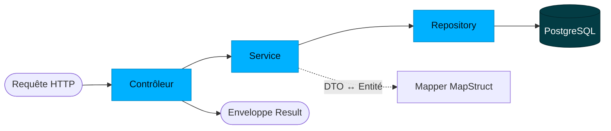

`candex-api` est une application Spring Boot en couches. Ce handbook couvre comment elle est construite ; pour le domaine qu'elle sert, voir [Base de données & Modèle](/fr/database/), et pour le système autour, [Architecture & Vue d'ensemble](/fr/architecture/).

## Flux d'une requête

Chaque requête traverse les mêmes couches. Les contrôleurs renvoient une enveloppe typée **`Result`** ; les services portent la logique ; les repositories sont du Spring Data JPA ; et la frontière entre entités JPA et formes de l'API est franchie par des mappers **MapStruct**.



## L'enveloppe de réponse

Chaque endpoint renvoie un `Result<T>` générique :

```json
{ "success": true, "data": { "...": "..." }, "error": null }
```

- `data` porte la charge utile en cas de succès ; `error` porte une erreur structurée en cas d'échec ; `success` est le drapeau.
- Les réponses de collection ajoutent un en-tête **`X-Total-Count`** ; les créations ajoutent un en-tête **`Location`**.

## Surface de l'API

Les chemins des ressources sont centralisés dans `ApiPaths` et exposés sous la base de l'API (par exemple `/api/drinks`). Environ **45 endpoints** répartis sur ~14 ressources (28 `GET`, 9 `POST`, 4 `DELETE`, 3 `PUT`, 1 `PATCH`) :

| Ressource | Chemin |
|-----------|--------|
| Drinks | `/drinks` (dont import en masse `import`, `import/diff`, `import/sync`) |
| Cans · Can formats | `/cans` · `/can-formats` |
| Brands | `/brands` |
| Flavors · Flavor categories | `/flavors` · `/flavor-categories` |
| Colors · Drink categories | `/colors` · `/drink-categories` |
| World Dex | `/world-dex` |
| Users · Unlocked drinks | `/users` · `/user-unlocked-drinks` |
| App versions · Reports | `/app-versions` · `/reports` |
| Console SQL admin | `/admin/...` |

La doc interactive est sur **Swagger UI** (`/swagger-ui.html`). Les contrats exacts requête/réponse relèvent du handbook **API / Contrats** *(à venir)*.

## Autorisation

Les endpoints sont gardés par `@PreAuthorize` et `SecurityExpressions` :

| Règle | Pour |
|-------|------|
| `USER_OR_ADMIN` | Lectures authentifiées (catalogue, World Dex) |
| `ADMIN_ONLY` | Écritures du catalogue et opérations admin |
| `PERMIT_ALL` | Les rares endpoints publics |
| `@securityAccess.canAccessUserId(...)` | Données propres à l'utilisateur — chacun ne touche que ses propres enregistrements |

L'identité vient de Firebase (voir [Architecture & Vue d'ensemble](/fr/architecture/#authentification--sécurité)).

## Services & logique métier

La logique métier est dans `service/core` — un service par ressource (`DrinkService`, `BrandService`, `WorldDexService`, `UserService`, …) — plus des services de support : `ImageService` (analyse), `UploaderService` (média), `ReportService` et `SqlConsoleService`.

## Gestion d'erreurs

Les erreurs sont renvoyées dans le champ `error` de l'enveloppe `Result`. Les exceptions dérivent d'un `CustomException` commun et se répartissent en deux familles :

| Famille | Exemples |
|---------|----------|
| `exception/api` | `ElementNotFoundException`, `InvalidFieldValueException`, `UniqueConstraintViolationException`, `ImmutableFieldModificationException`, `MissingRequiredFieldException`, `SqlExecutionException` |
| `exception/business` | `InvalidDexPositionException`, `MissingRequiredCanException`, `MissingRequiredLocalizationException`, `DrinkAlreadyHasPredecessorException`, `InvalidEditionConfigurationException` |

Les exceptions `api` décrivent des problèmes de requête/données ; les exceptions `business` décrivent des violations de règles métier.

## Validation

Les DTO de requête sont validés avec Bean Validation, câblé via `ValidationConfig`. Une entrée invalide ressort en erreur `api` plutôt que d'atteindre la couche service.

## Jobs planifiés

Deux jobs de fond tournent périodiquement :

- `UnverifiedUserCleanupJob` — supprime les utilisateurs n'ayant jamais vérifié leur compte.
- `WorldDexHistoryPruneJob` — élague l'ancien historique du World Dex.

## Configuration

La configuration vit dans `config` et dépend du profil (`dev` / `prod`) : `OpenApiConfig` (Swagger), `CorsConfig` (origines autorisées), `JacksonConfig` (JSON), `SqlConsoleConfig` et `ValidationConfig`. Pour la lancer en local, voir [Installation locale](/fr/local-installation/) ; les spécificités d'environnement relèvent du handbook **Déploiement** *(à venir)*.

## Conventions

- Les contrôleurs renvoient `ResponseEntity<Result<T>>` ; les chemins viennent des constantes `ApiPaths`.
- Les entités ne quittent jamais la frontière du service — les DTO (`dto/request`, `dto/response`) la franchissent via les mappers MapStruct.
- Chaque endpoint déclare son accès avec `@PreAuthorize`.
- Les erreurs sont des exceptions structurées (`api` / `business`) exposées via l'enveloppe `Result`.
