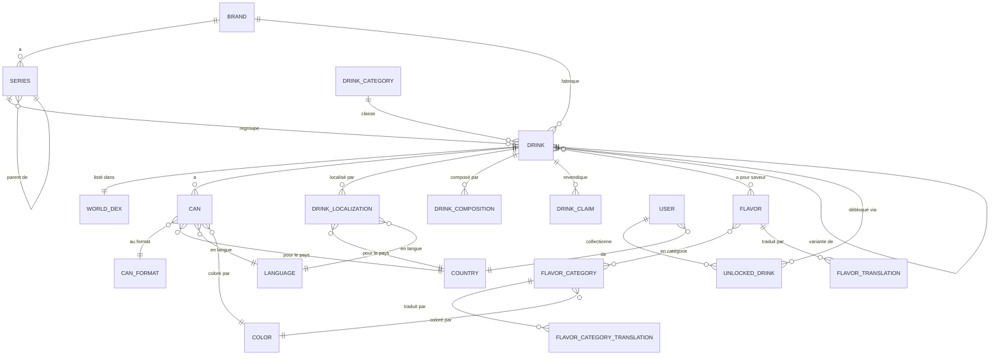

Voici la référence des données de Candex. Le domaine vit dans **PostgreSQL**, et le schéma est entièrement détenu par les migrations **Flyway**. Pour la vue d'ensemble et le cœur simplifié, voir [Architecture & Vue d'ensemble](/fr/architecture/).

## Organisation du schéma

Le schéma de base est posé par les migrations `V1`–`V6`, en trois domaines plus la mécanique runtime :

| Migration | Domaine |
|-----------|---------|
| `V1` — core reference schema | Tables de référence : pays, langues, couleurs, catégories, versions d'app |
| `V2` — user data schema | Utilisateurs et leurs boissons débloquées |
| `V3` — catalogue & dex schema | Marques, séries, boissons, canettes, saveurs, World Dex |
| `V4` — runtime routines | Fonctions PostgreSQL |
| `V5` — runtime triggers | Triggers qui maintiennent l'ordre du World Dex |
| `V6` — static reference data | Seeds des tables de référence |

## Le modèle d'entités

Le catalogue est un graphe autour de **Drink**. Une boisson appartient à une marque, une série et une catégorie ; possède des canettes, localisations, compositions et revendications ; a une ou plusieurs saveurs ; et est listée une fois dans le World Dex. Les utilisateurs collectionnent les boissons en les débloquant.

Quelques points que le diagramme abstrait :

- **Catalogue versionné.** La plupart des entités de catalogue et de référence (`Brand`, `Series`, `Flavor`, `Color`, `Country`, `Language`, `DrinkCategory`, `CanFormat`, `User`) portent un lien `introduced_in_version` vers `AppVersion` : chaque ligne est rattachée à la version d'app qui l'a introduite. Ces arêtes sont omises du diagramme pour rester lisible.
- **Tables de jointure à clé composite.** `UserUnlockedDrink` (user + drink), `DrinkLocalization` (drink + country + language), `FlavorTranslation`, `FlavorCategoryTranslation` et `DrinkCountry` utilisent des clés primaires composites (voir `entity/id`).
- **Ordonnancement World Dex.** `WorldDexArrival` et `WorldDexHistory` suivent l'ordre et l'arrivée des entrées ; cet ordre est maintenu dans la base (voir plus bas).

## Données de référence & seeds

Les tables de référence (pays, langues, couleurs, catégories de boisson, formats de canette) et les premières versions d'app sont seedées par migrations, donc une base neuve est directement utilisable. Les baselines de marques et séries (par exemple Monster et Coca-Cola) sont seedées dans des migrations ultérieures (`V13`, `V14`). Comme le catalogue est versionné, les lignes de référence et de catalogue sont introduites contre une `AppVersion` précise.

## Migrations & Flyway

Flyway détient le schéma (`spring.flyway.enabled=true`, `locations=classpath:db/migration`).

- `V1`–`V6` sont la **baseline canonique** pour les bases vides ; les bases non vides existantes sont baseline à la version `6`.
- Tout changement ultérieur est une migration **incrémentale** `V7+`.
- Les migrations appliquées sont **immuables** — ne jamais renommer, réordonner ou éditer une migration après déploiement.
- Les scripts snapshot legacy sont conservés sous `src/main/resources/sql/archive/`.

Pour changer le schéma ou les données de référence, ajoutez le prochain fichier `V<n>__courte_description.sql` ; il s'exécute automatiquement au prochain démarrage de l'API.

## Ordonnancement du World Dex

Le World Dex est un catalogue **ordonné**, et cet ordre est maintenu **dans la base** plutôt que dans l'app. Des routines PostgreSQL (`V4`) et des triggers (`V5`) décalent les entrées lors des insertions ou suppressions de boissons, afin que les positions restent contiguës et correctes. Cette logique a été affinée au fil de plusieurs migrations (`V9`, `V12`, `V17`–`V20`) ; les fichiers de migration font foi pour le comportement exact. Le handbook **[Back-end](/fr/back-end/)** couvre la façon dont l'API l'expose.

## Console SQL en lecture seule

La migration `V16` provisionne un **rôle de base en lecture seule** pour une inspection sûre. Son mot de passe vient du placeholder Flyway `readonly_password` (`CANDEX_SQLCONSOLE_READONLY_PASSWORD`). Ce rôle alimente la console SQL du tableau de bord admin, pour exécuter des requêtes sans accès en écriture.

## Conventions

- Tables et colonnes en `snake_case` ; les clés étrangères sont `<entité>_id` (ou un code naturel comme `country_code`, `language_code`).
- Les tables de jointure et de traduction utilisent des **clés primaires composites**, définies dans `entity/id`.
- Les migrations sont **versionnées et immuables** ; la base n'est jamais éditée à la main.
- Les lignes de catalogue et de référence sont rattachées à une `AppVersion` via `introduced_in_version`.

## Pour aller plus loin

- Les couches qui l'utilisent → [Back-end](/fr/back-end/)
- Les termes derrière les tables → [Glossaire](/fr/glossary/)
- Comment elle est sauvegardée → [Backups](/fr/backups/)
