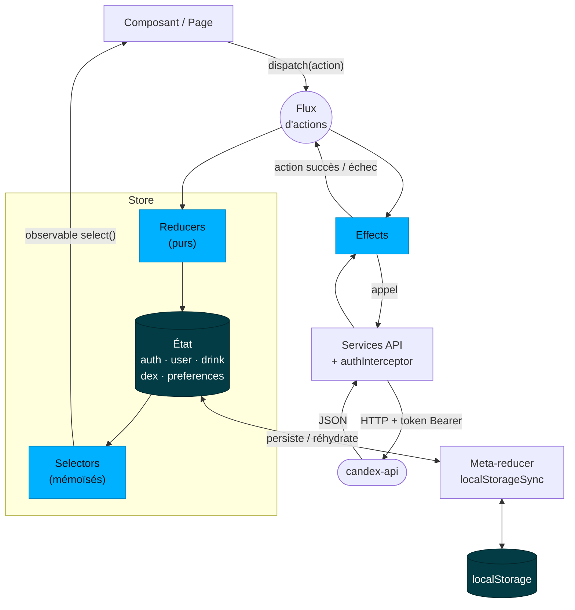
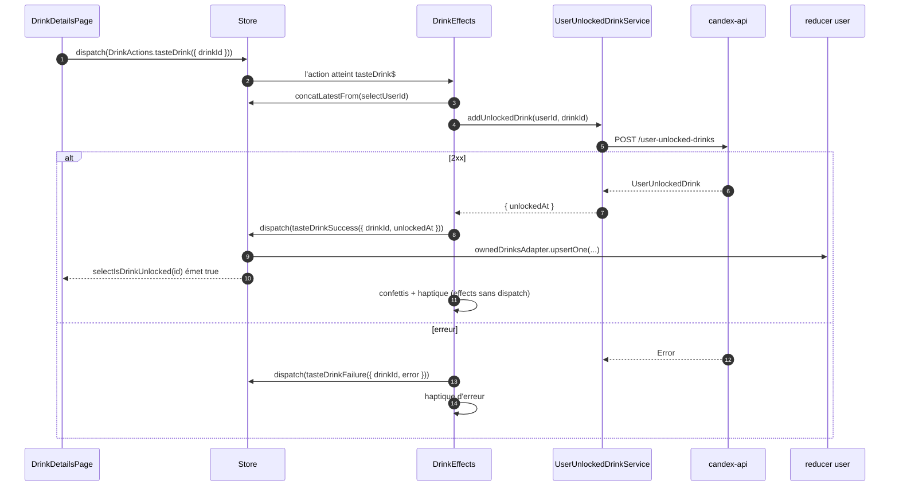

Candex a deux front-ends Angular + Ionic qui consomment le même [Back-end](/fr/back-end/) : l'**app mobile** que tiennent les utilisateurs, et le **tableau de bord admin** qui garde le catalogue à jour. Pour le système autour, voir [Architecture & Vue d'ensemble](/fr/architecture/).

## App mobile (`candex-app`)

Angular 20 + Ionic 8 + Capacitor 7, construite en **composants standalone** (pas de NgModules), structurée par feature, avec **NgRx** pour l'état.

### Couches & leurs rôles

| Couche | Dossier | Rôle |
|--------|---------|------|
| **Pages** | `pages` | Écrans routés : le flux d'auth, le shell `tabs` (home / dex / profile), le détail d'une boisson, et les réglages |
| **Composants** | `components` | Briques d'UI réutilisables partagées entre les pages |
| **Services** | `services` | Effets de bord & intégrations : le client API (`api`), plus `auth`, `storage`, `theme`, `language`, `upload-care`, `haptics`, `native-app`, `dex-navigation` / `dex-ui`, `ui-alert`, et `app-initializer` |
| **Store** | `store` | État NgRx — une slice par domaine (voir plus bas) |
| **Guards** | `guards` | Protection des routes (`auth`, `app`) — tenir les non-authentifiés hors des écrans protégés |
| **Interceptors** | `interceptors` | `auth.interceptor` attache le token Firebase à chaque requête API |
| **Pipes** | `pipes` | Formatage de vue — ex. `dynamic-locale-date` pour les dates localisées |

Le principe est le même qu'au back-end : **les composants affichent et dispatchent ; les services et le store font le travail**. Un composant n'appelle jamais l'API directement.

### État avec NgRx

L'état est découpé en slices — `app`, `auth`, `dex`, `drink`, `preferences`, `user` — chacune une unité NgRx complète (`actions`, `reducer`, `effects`, `selectors`, `state`). Le flux est à sens unique :



Les règles derrière le schéma :

- **Les composants ne font que dispatcher et sélectionner.** Toutes les actions passent dans un flux unique ; **reducers** et **effects** l'écoutent tous les deux. Un composant ne sait jamais lequel des deux traite une action.
- **Les reducers sont purs** — `(état, action) → nouvel état`, aucune I/O. Les collections sont des adapters `@ngrx/entity` (`drinksAdapter` pour le catalogue, `ownedDrinksAdapter` pour la collection de l'utilisateur).
- **Les effects portent les effets de bord** — HTTP, Firebase, navigation, toasts, haptique — et répondent toujours par une nouvelle action (`…Success` / `…Failure`), jamais en écrivant eux-mêmes dans l'état.
- **Les slices réagissent entre elles via les actions**, pas via des imports : les effects `drink` émettent `tasteDrinkSuccess`, et c'est le reducer `user` qui enregistre la boisson possédée.
- **Les selectors joignent les slices** : `DrinkSelectors.selectDrinks` fusionne le catalogue (`drink`) et les boissons possédées (`user`) en `DrinkWithUnlock`, chaque boisson porte ainsi son `unlockedAt` sans être stockée deux fois.
- **Persistance** — le meta-reducer `localStorageSync` (dans `main.ts`) recopie les slices `auth`, `user`, `drink`, `dex` et `preferences` dans le `localStorage` et les réhydrate au démarrage : un relancement affiche le Dex instantanément et `AppActions.loadApp` le rafraîchit en arrière-plan. Ionic Storage (`StorageService`) sert à part, pour des valeurs hors store.

### Une action, de bout en bout

Appuyer sur « goûtée » sur une boisson :



Pas de mise à jour optimiste : la boisson n'apparaît goûtée qu'une fois confirmée par l'API.

### La même action dans le code

Chaque étape du schéma tient en quelques lignes, dans son propre fichier. L'**action** nomme l'intention et ne porte que le nécessaire (`store/drink/drink.actions.ts`) :

```ts
const tasteDrink = createAction(
  '[Drinks] Taste Drink',
  props<{ drinkId: number }>()
);
```

La **page** lit le store via un selector et dispatche — elle n'appelle jamais l'API :

```ts
private readonly drinks = toSignal(
  this.store.select(DrinkSelectors.selectDrinks),
  { initialValue: [] }
);

private dispatchTaste(drinkId: number): void {
  this.store.dispatch(DrinkActions.tasteDrink({ drinkId }));
}
```

L'**effect** fait l'I/O et répond par une nouvelle action. `concatLatestFrom` lit l'id utilisateur dans le store seulement à l'arrivée de l'action ; `mergeMap` permet de goûter deux boissons en parallèle :

```ts
tasteDrink$ = createEffect(() => {
  return this.actions$.pipe(
    ofType(DrinkActions.tasteDrink),
    concatLatestFrom(() => this.store.select(UserSelectors.selectUserId)),
    filter(([, userId]) => Boolean(userId)),
    mergeMap(([{ drinkId }, userId]) =>
      this.userUnlockedDrinkService.addUnlockedDrink(userId as number, drinkId).pipe(
        map((unlocked) => DrinkActions.tasteDrinkSuccess({
          drinkId,
          unlockedAt: unlocked.unlockedAt,
        })),
        catchError((error) => of(DrinkActions.tasteDrinkFailure({ drinkId, error })))
      )
    )
  );
});
```

Le **reducer** d'une autre slice (`user`) enregistre le résultat — pur, sans I/O :

```ts
on(DrinkActions.tasteDrinkSuccess, (state, { drinkId, unlockedAt }): UserState => ({
  ...state,
  ownedDrinks: ownedDrinksAdapter.upsertOne({ drinkId, unlockedAt }, state.ownedDrinks),
})),
```

Et le **selector** joint les deux slices, si bien que chaque abonné de `selectDrinks` voit le nouvel `unlockedAt` :

```ts
const selectDrinks = createSelector(
  selectRawDrinks,
  UserSelectors.selectOwnedDrinkEntities,
  (drinks, owned): DrinkWithUnlock[] =>
    drinks.map((drink) => ({
      ...drink,
      unlockedAt: owned[drink.id]?.unlockedAt ?? undefined,
    }))
);
```

### Ajouter le token

Les services n'ajoutent jamais eux-mêmes l'en-tête `Authorization` : `auth.interceptor.ts` le fait pour chaque requête vers l'API, et laisse passer tout le reste intact :

```ts
export const authInterceptor: HttpInterceptorFn = (request, next) => {
  if (!request.url.startsWith(environment.apiUrl)) {
    return next(request);
  }

  return from(whenAuthReady(firebase.auth())).pipe(
    switchMap((user) => {
      if (!user) {
        return next(request); // invité : endpoints publics uniquement
      }

      return from(user.getIdToken()).pipe(
        switchMap((token) => next(request.clone({
          setHeaders: { Authorization: `Bearer ${token}` },
        })))
      );
    })
  );
};
```

`getIdToken()` renvoie le token en cache et le rafraîchit seul quand il va expirer : l'interceptor n'a jamais à gérer l'expiration.

### Navigation

Les routes sont standalone : le flux **auth** (`welcome`, `register`, `login`, `complete-profile`, `verify-email`, `two-factor`), le shell **tabs** (`home`, `dex`, `profile`), `drink-details/:drinkId`, et les **réglages** (`account`, `preferences`, `about`).

### Préoccupations transverses

- **Localisation** — `ngx-translate` avec un service `language`, et un pipe `dynamic-locale-date` pour les dates.
- **Thème** — un service `theme` pilote le clair / sombre.
- **Natif** — plugins Capacitor (haptics, clavier), un service `native-app`, et Firebase Authentication via Capacitor.
- **Média** — upload d'images via Uploadcare (service `upload-care`) et recadrage via `ngx-image-cropper`.

## Tableau de bord admin (`candex-dashboard`)

Angular 20 + Ionic 8 + **Angular Material**, pour gérer le catalogue. Il est volontairement plus simple que l'app : **état par services** (pas de NgRx), organisé en `components`, `pages`, `services`, `interceptors` et `interfaces`. Un interceptor attache les identifiants admin aux appels API, et il dialogue avec la même API REST. Sa console SQL s'appuie sur le rôle en lecture seule de l'API (voir [Base de données & Modèle](/fr/database/#console-sql-en-lecture-seule)).

## Où aller ensuite

- Look & feel, composants, tokens → **UI/UX (+ Design System)** *(à venir)*
- L'API que consomment les front-ends → [Back-end](/fr/back-end/)
- La vue d'ensemble → [Architecture & Vue d'ensemble](/fr/architecture/)
