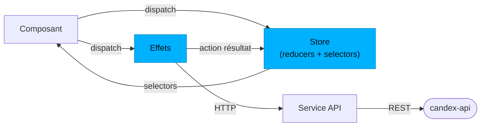

Candex a deux front-ends Angular + Ionic qui consomment le même [Back-end](/fr/back-end/) : l'**app mobile** que tiennent les utilisateurs, et le **tableau de bord admin** qui garde le catalogue à jour. Pour le système autour, voir [Architecture & Vue d'ensemble](/fr/architecture/).

## App mobile (`candex-app`)

Angular 20 + Ionic 8 + Capacitor 7, construite en **composants standalone** (pas de NgModules), structurée par feature, avec **NgRx** pour l'état.

### Couches & leurs rôles

| Couche | Dossier | Rôle |
|--------|---------|------|
| **Pages** | `pages` | Écrans routés : le flux d'auth, le shell `tabs` (home / dex / profile), le détail d'une boisson, et les réglages |
| **Composants** | `components` | Briques d'UI réutilisables partagées entre les pages |
| **Services** | `services` | Effets de bord & intégrations : le client API (`api`), plus `auth`, `storage`, `theme`, `language`, `upload-care`, `haptics`, `native-app`, `dex-navigation` / `dex-ui`, `ui-alert`, et `app-initializer` |
| **Store** | `store` | État NgRx — une slice par domaine (voir plus bas) |
| **Guards** | `guards` | Protection des routes (`auth`, `app`) — tenir les non-authentifiés hors des écrans protégés |
| **Interceptors** | `interceptors` | `auth.interceptor` attache le token Firebase à chaque requête API |
| **Pipes** | `pipes` | Formatage de vue — ex. `dynamic-locale-date` pour les dates localisées |

Le principe est le même qu'au back-end : **les composants affichent et dispatchent ; les services et le store font le travail**. Un composant n'appelle jamais l'API directement.

### État avec NgRx

L'état est découpé en slices — `app`, `auth`, `dex`, `drink`, `preferences`, `user` — chacune une unité NgRx complète (`actions`, `reducer`, `effects`, `selectors`, `state`). Le flux est à sens unique :

Un composant **dispatche** une action ; un **reducer** met à jour la slice de façon pure, ou un **effect** appelle le service API et dispatche une action résultat ; les **selectors** renvoient le nouvel état aux composants. La persistance de l'état entre les lancements est assurée par `ngrx-store-localstorage` + Ionic Storage.

### Navigation

Les routes sont standalone : le flux **auth** (`welcome`, `register`, `login`, `complete-profile`, `verify-email`, `two-factor`), le shell **tabs** (`home`, `dex`, `profile`), `drink-details/:drinkId`, et les **réglages** (`account`, `preferences`, `about`).

### Préoccupations transverses

- **Localisation** — `ngx-translate` avec un service `language`, et un pipe `dynamic-locale-date` pour les dates.
- **Thème** — un service `theme` pilote le clair / sombre.
- **Natif** — plugins Capacitor (haptics, clavier), un service `native-app`, et Firebase Authentication via Capacitor.
- **Média** — upload d'images via Uploadcare (service `upload-care`) et recadrage via `ngx-image-cropper`.

## Tableau de bord admin (`candex-dashboard`)

Angular 20 + Ionic 8 + **Angular Material**, pour gérer le catalogue. Il est volontairement plus simple que l'app : **état par services** (pas de NgRx), organisé en `components`, `pages`, `services`, `interceptors` et `interfaces`. Un interceptor attache les identifiants admin aux appels API, et il dialogue avec la même API REST. Sa console SQL s'appuie sur le rôle en lecture seule de l'API (voir [Base de données & Modèle](/fr/database/#console-sql-en-lecture-seule)).

## Où aller ensuite

- Look & feel, composants, tokens → **UI/UX (+ Design System)** *(à venir)*
- L'API que consomment les front-ends → [Back-end](/fr/back-end/)
- La vue d'ensemble → [Architecture & Vue d'ensemble](/fr/architecture/)
