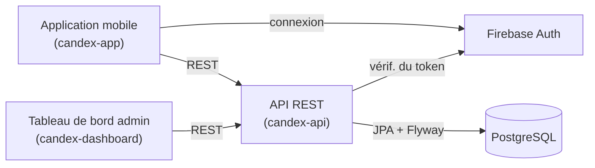

Cette page vous oriente si vous allez travailler sur Candex. Pour le produit lui-même — ce que c'est et l'expérience — commencez par [Prise en main — Produit](/fr/getting-started/).

## Le système en un coup d'œil

Candex n'est pas une seule application mais plusieurs pièces qui fonctionnent ensemble. Les utilisateurs utilisent l'**application mobile**. Un **tableau de bord d'administration** garde le catalogue à jour. Les deux dialoguent avec une seule **API REST**, qui détient le domaine et stocke tout dans **PostgreSQL**. L'authentification est gérée par **Firebase**.

## Dépôts

L'espace de travail contient six dépôts. Trois forment le système vivant ci-dessus ; les autres sont soit remplacés, soit à un stade précoce.

| Dépôt | Rôle | Statut |
|-------|------|--------|
| `candex-app` | Client mobile (Angular + Ionic + Capacitor) | Actif |
| `candex-dashboard` | Tableau de bord d'administration du catalogue | Actif |
| `candex-api` | API REST et modèle de domaine, adossée à PostgreSQL | Actif |
| `candex-backups` | Outils de sauvegarde Firestore | Déprécié — antérieur au passage à PostgreSQL |
| `candex-api-legacy` | Ancienne API (Node.js / Express) | Déprécié |
| `candex-ai` | Module IA (Python) | Précoce / ébauche |

## Stack technique

**Front-end** — l'application mobile et le tableau de bord

  <a class="tech-card" href="https://angular.dev" target="_blank" rel="noopener">Angularv20</a>
  <a class="tech-card" href="https://ionicframework.com" target="_blank" rel="noopener">Ionicv8</a>
  <a class="tech-card" href="https://capacitorjs.com" target="_blank" rel="noopener">Capacitorv7</a>
  <a class="tech-card" href="https://www.typescriptlang.org" target="_blank" rel="noopener">TypeScript</a>
  <a class="tech-card" href="https://ngrx.io" target="_blank" rel="noopener">NgNgRxStore · Effects · Entity</a>
  <a class="tech-card" href="https://rxjs.dev" target="_blank" rel="noopener">RxJS</a>
  <a class="tech-card" href="https://material.angular.io" target="_blank" rel="noopener">MatAngular Materialtableau de bord</a>
  <a class="tech-card" href="https://firebase.google.com/products/auth" target="_blank" rel="noopener">FirebaseAuth</a>

**Back-end** — l'API REST

  <a class="tech-card" href="https://spring.io/projects/spring-boot" target="_blank" rel="noopener">Spring Bootv3.5</a>
  <a class="tech-card" href="https://openjdk.org" target="_blank" rel="noopener">Java21</a>
  <a class="tech-card" href="https://maven.apache.org" target="_blank" rel="noopener">MvnMavenbuild (wrapper)</a>
  <a class="tech-card" href="https://www.postgresql.org" target="_blank" rel="noopener">PostgreSQL</a>
  <a class="tech-card" href="https://www.red-gate.com/products/flyway/" target="_blank" rel="noopener">FwFlywaymigrations</a>
  <a class="tech-card" href="https://mapstruct.org" target="_blank" rel="noopener">MsMapStructmapping</a>
  <a class="tech-card" href="https://spring.io/projects/spring-security" target="_blank" rel="noopener">OA2Spring SecurityOAuth2</a>
  <a class="tech-card" href="https://swagger.io" target="_blank" rel="noopener">OpenAPIspringdoc</a>

**Qualité & livraison**

  <a class="tech-card" href="https://www.docker.com" target="_blank" rel="noopener">DockerCompose</a>
  <a class="tech-card" href="https://junit.org" target="_blank" rel="noopener">JUJUnit+ Mockito</a>
  <a class="tech-card" href="https://testcontainers.com" target="_blank" rel="noopener">TcTestcontainers</a>
  <a class="tech-card" href="https://www.jacoco.org/jacoco/" target="_blank" rel="noopener">JcJaCoCocouverture</a>
  <a class="tech-card" href="https://eslint.org" target="_blank" rel="noopener">ESLint</a>
  <a class="tech-card" href="https://www.cypress.io" target="_blank" rel="noopener">Cypresse2e</a>

## Où vivent les choses

- **Domaine & API** — `candex-api`. Entités et règles métier dans `src/main/java` ; schéma dans PostgreSQL, qui évolue via les migrations Flyway sous `src/main/resources/db/migration`.
- **UI mobile** — `candex-app` (Angular + Ionic, NgRx pour l'état).
- **UI admin** — `candex-dashboard` (Angular + Ionic + Angular Material).

Le code est la source de vérité : quand la documentation et le code divergent, le code fait foi et la doc est corrigée.

## L'installer en local

Candex tourne sous forme de trois applications — l'application mobile et le tableau de bord (Ionic/Angular, lancés avec npm) et l'API (Maven + Spring Boot, avec PostgreSQL), chacune dans trois environnements (local, dev, prod). L'installation complète — prérequis, clonage, fichiers d'environnement, base de données, et les commandes par application — vit dans le handbook **Local Installation** (à venir).

## Où aller ensuite

- Configurer votre machine → Local Installation *(à venir)*
- Comprendre l'assemblage et le pourquoi → Architecture & Vue d'ensemble *(à venir)*
- Le langage précis du domaine → Glossaire / Domaine *(à venir)*

**Votre première étape :** clonez les dépôts, puis suivez Local Installation pour lancer l'API et au moins un front contre une base locale.
