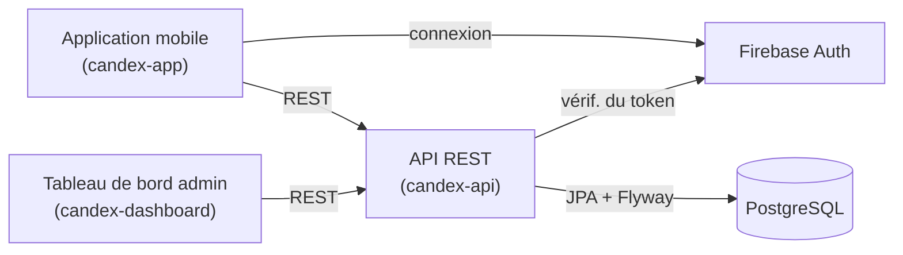

Commencez par cette page. Elle explique ce qu'est Candex, comment il fonctionne pour celles et ceux qui l'utilisent, de quoi le projet est fait, et où aller ensuite. Les autres handbooks approfondissent chaque domaine ; celui-ci donne la vue d'ensemble.

## Ce qu'est Candex

Candex est une application mobile qui transforme la **découverte et la collection de boissons en jeu**. Vous explorez des boissons du monde entier, marquez celles que vous avez goûtées ou possédez, et complétez un catalogue personnel — votre **World Dex** — comme on complète une collection dans un jeu vidéo.

L'idée est simple : rendre la découverte de boissons aussi motivante qu'une collection. Chaque boisson débloquée s'illumine dans votre Dex, votre progression est visible, et il y a toujours quelque chose de nouveau à trouver.

Candex s'adresse à plusieurs profils :

- **Explorateurs** — qui veulent découvrir des boissons locales, rares ou populaires ailleurs.
- **Collectionneurs** — qui veulent compléter leur World Dex et traquer ce qui leur manque.
- **Partageurs** — qui aiment montrer une belle trouvaille.

Ce que vous pouvez faire dans l'application :

- **Découvrir** des boissons du monde entier
- **Débloquer** celles que vous avez goûtées ou possédez
- **Voir votre World Dex se remplir** à mesure que votre collection grandit
- **Parcourir** par marque, série et saveur
- **Personnaliser** votre profil

## Comment ça marche

L'expérience est une boucle simple :

1. **Découvrir** — parcourir le catalogue de boissons, organisé par marque, série et saveur.
2. **Débloquer** — marquer une boisson comme collectée. Elle s'illumine dans votre World Dex.
3. **Progresser** — votre World Dex se complète au fil du temps, et vous voyez où vous en êtes.

Tout le reste — profils, synchronisation, la partie admin qui garde le catalogue à jour — existe pour soutenir cette boucle.

## Concepts clés

Quelques mots reviennent dans Candex et dans toute cette documentation. Les voici en clair ; le handbook **Glossaire / Domaine** (à venir) définira chacun précisément par rapport au modèle de données.

| Terme | Signification |
|-------|---------------|
| Drink | Une boisson du catalogue — ce que l'on collectionne. |
| Can | Une canette ou un packaging physique d'une boisson (une boisson peut en avoir plusieurs). |
| Brand | L'entreprise qui fabrique une boisson (par exemple Monster ou Coca-Cola). |
| Series | Une gamme au sein d'une marque (par exemple Monster Ultra). |
| Flavour | La saveur d'une boisson, traduite selon la langue. |
| World Dex | Votre catalogue de collection global — ce que vous complétez. |
| Unlock | Marquer une boisson comme collectée, pour qu'elle compte dans votre Dex. |

:::note
D'anciennes notes produit mentionnent des idées comme *intake* ou *wishlist*. Elles ne font pas partie de l'application aujourd'hui ; elles sont donc laissées de côté ici et seront documentées si elles sont développées.
:::

## Le système derrière

Candex n'est pas une seule application mais plusieurs pièces qui fonctionnent ensemble. Les utilisateurs utilisent l'**application mobile**. Un **tableau de bord d'administration** garde le catalogue à jour. Les deux dialoguent avec une seule **API REST**, qui détient le domaine et stocke tout dans **PostgreSQL**. L'authentification est gérée par **Firebase**.

L'espace de travail contient six dépôts. Trois forment le système vivant ci-dessus ; les autres sont soit remplacés, soit à un stade précoce.

| Dépôt | Rôle | Statut |
|-------|------|--------|
| `candex-app` | Client mobile (Angular + Ionic + Capacitor) | Actif |
| `candex-dashboard` | Tableau de bord d'administration du catalogue | Actif |
| `candex-api` | API REST et modèle de domaine, adossée à PostgreSQL | Actif |
| `candex-backups` | Outils de sauvegarde Firestore | Déprécié — antérieur au passage à PostgreSQL |
| `candex-api-legacy` | Ancienne API (Node.js / Express) | Déprécié |
| `candex-ai` | Module IA (Python) | Précoce / ébauche |

Le handbook **Architecture & Vue d'ensemble** (à venir) détaille comment tout cela s'assemble et pourquoi.

## Stack technique

**Front-end** — l'application mobile et le tableau de bord

  <a class="tech-card" href="https://angular.dev" target="_blank" rel="noopener">Angularv20</a>
  <a class="tech-card" href="https://ionicframework.com" target="_blank" rel="noopener">Ionicv8</a>
  <a class="tech-card" href="https://capacitorjs.com" target="_blank" rel="noopener">Capacitorv7</a>
  <a class="tech-card" href="https://www.typescriptlang.org" target="_blank" rel="noopener">TypeScript</a>
  <a class="tech-card" href="https://ngrx.io" target="_blank" rel="noopener">NgNgRxStore · Effects · Entity</a>
  <a class="tech-card" href="https://rxjs.dev" target="_blank" rel="noopener">RxJS</a>
  <a class="tech-card" href="https://material.angular.io" target="_blank" rel="noopener">MatAngular Materialtableau de bord</a>
  <a class="tech-card" href="https://firebase.google.com/products/auth" target="_blank" rel="noopener">FirebaseAuth</a>

**Back-end** — l'API REST

  <a class="tech-card" href="https://spring.io/projects/spring-boot" target="_blank" rel="noopener">Spring Bootv3.5</a>
  <a class="tech-card" href="https://openjdk.org" target="_blank" rel="noopener">Java21</a>
  <a class="tech-card" href="https://maven.apache.org" target="_blank" rel="noopener">MvnMavenbuild (wrapper)</a>
  <a class="tech-card" href="https://www.postgresql.org" target="_blank" rel="noopener">PostgreSQL</a>
  <a class="tech-card" href="https://www.red-gate.com/products/flyway/" target="_blank" rel="noopener">FwFlywaymigrations</a>
  <a class="tech-card" href="https://mapstruct.org" target="_blank" rel="noopener">MsMapStructmapping</a>
  <a class="tech-card" href="https://spring.io/projects/spring-security" target="_blank" rel="noopener">OA2Spring SecurityOAuth2</a>
  <a class="tech-card" href="https://swagger.io" target="_blank" rel="noopener">OpenAPIspringdoc</a>

**Qualité & livraison**

  <a class="tech-card" href="https://www.docker.com" target="_blank" rel="noopener">DockerCompose</a>
  <a class="tech-card" href="https://junit.org" target="_blank" rel="noopener">JUJUnit+ Mockito</a>
  <a class="tech-card" href="https://testcontainers.com" target="_blank" rel="noopener">TcTestcontainers</a>
  <a class="tech-card" href="https://www.jacoco.org/jacoco/" target="_blank" rel="noopener">JcJaCoCocouverture</a>
  <a class="tech-card" href="https://eslint.org" target="_blank" rel="noopener">ESLint</a>
  <a class="tech-card" href="https://www.cypress.io" target="_blank" rel="noopener">Cypresse2e</a>

## Installer Candex en local

Candex tourne sous forme de trois applications : l'**application mobile** et le **tableau de bord** (tous deux Ionic/Angular, lancés avec npm) et l'**API** (Maven + Spring Boot, avec une base PostgreSQL). Chacune tourne dans trois environnements — local, dev et prod.

L'installation de bout en bout — prérequis, clonage, fichiers d'environnement, base de données, et les commandes par application et par environnement — mérite son propre guide. Elle vivra dans le handbook **Local Installation** (à venir), donc cette page ne la duplique pas.

## Où aller ensuite

La documentation est un ensemble de handbooks ciblés. L'anglais est la langue canonique ; une version française est disponible via le sélecteur de langue. Chaque page prend en charge les thèmes Système / Clair / Sombre, la recherche plein texte et un export PDF par handbook.

**Disponible**

- Prise en main — ce handbook.

**À venir**

- Architecture & Vue d'ensemble · Glossaire / Domaine · Produit · UI/UX (+ Design System) · Front-end · Back-end · API / Contrats · Base de données / Modèle · Local Installation · Qualité logicielle · Tests · Déploiement · Backups · Sécurité

Les handbooks à venir sont listés pour montrer le périmètre complet ; ils seront liés ici au fur et à mesure de leur rédaction.
