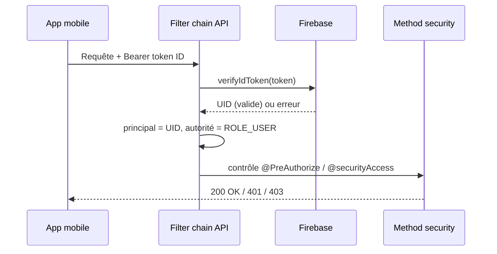

La sécurité est imposée dans l'**API**. L'authentification décide *qui* appelle ; l'autorisation décide *ce qu'*il peut faire. La couche HTTP reste volontairement fine — elle définit le mécanisme d'authentification et quelques routes publiques — tandis que les vraies règles métier vivent dans la method security, à côté des endpoints qu'elles protègent.

## L'authentification d'une requête en un coup d'œil

## Authentification

Deux mécanismes coexistent.

Les **tokens Firebase** sont la voie principale, pour les utilisateurs de l'app. Une requête porte `Authorization: Bearer <token>` ; le `FirebaseAuthenticationFilter` le vérifie (`FirebaseAuth.verifyIdToken`) et, en cas de succès, pose une authentification Spring Security dont le **principal est l'UID Firebase** et l'autorité `ROLE_USER`. La vérification est non bloquante : si le token est absent, invalide, expiré ou révoqué, le filtre vide simplement le contexte et laisse l'autorisation rejeter la requête en aval. Firebase est la source de vérité pour l'identité applicative.

Une **Basic Auth HTTP interim** couvre l'administrateur. Un magasin d'utilisateurs en mémoire (`InMemoryUserDetailsManager`) contient deux comptes chargés depuis des variables d'environnement — un `user` standard (`ROLE_USER`) et un `admin` (`ROLE_ADMIN`) — avec des mots de passe hashés en BCrypt. Le code la documente comme un pont temporaire, destiné à être remplacé plus tard par une authentification JWT.

La filter chain est **stateless** (`SessionCreationPolicy.STATELESS`), le **CSRF est désactivé** (il n'y a ni session serveur ni cookie à protéger), et le **CORS** est géré par un `CorsFilter` dédié avec une liste d'origines autorisées fixe (`CorsOrigins`).

## Rôles

Il y a deux autorités — `ROLE_USER` et `ROLE_ADMIN` (`SecurityRoles`).

## Autorisation

L'autorisation s'exécute sur deux couches.

**À la couche HTTP** (`SecurityConfig`), seules quelques règles sont déclarées :

- **Public** — `/error`, `/actuator/health`, l'inscription (`POST /users`) et le test d'existence (`GET /users/exists`).
- **Admin uniquement** — l'UI Swagger et la doc OpenAPI (`/swagger-ui/**`, `/v3/api-docs/**`) et l'actuator (`/actuator/**`).
- **Tout le reste** — authentifié.

**À la couche méthode** (`@EnableMethodSecurity`), chaque endpoint porte une règle `@PreAuthorize`, construite à partir de `SecurityExpressions` réutilisables :

- `USER_OR_ADMIN` — tout utilisateur authentifié ou admin.
- `ADMIN_ONLY` — autorité admin requise (écritures du catalogue, imports, opérations d'admin).
- `PERMIT_ALL` — explicitement ouvert.

Les endpoints liés à la propriété passent par le bean `@securityAccess` (`SecurityAccess`) plutôt que par un rôle seul, p. ex. `@PreAuthorize("@securityAccess.canAccessUserId(authentication, #id)")`. La règle est constante : un **admin contourne la propriété**, sinon l'UID Firebase (ou l'id utilisateur) de l'appelant doit correspondre au propriétaire de la ressource. Le même bean garde aussi l'accès par UID Firebase (`canAccessFirebaseUid`) et la gestion des boissons débloquées (`canManageUserUnlockedDrink`).

## Secrets

Aucun credential ni clé n'est versionné. Le compte de service Firebase est chargé à l'exécution depuis un chemin de fichier configuré (`candex.firebase.config-path`), jamais depuis le dépôt. Les comptes Basic Auth (`candex.security.*`) et les credentials de la base viennent de variables d'environnement, par profil Spring — les dépôts ne livrent que des fichiers `.env.example` avec des placeholders. Voir [Installation locale](/fr/local-installation/) pour les définir en local et [Déploiement](/fr/deployment/) pour les environnements déployés.

## Côté client

L'app mobile authentifie les utilisateurs avec **Firebase Authentication** et appelle l'API avec le token d'ID obtenu dans l'en-tête `Authorization` ; l'API fait confiance à Firebase pour avoir authentifié l'utilisateur et dérive l'identité du token vérifié. Voir [Architecture](/fr/architecture/) pour la façon dont les pièces s'assemblent.

## Pour aller plus loin

- Les endpoints que ces règles protègent → [API / Contrats](/fr/api-contracts/)
- Les couches derrière → [Back-end](/fr/back-end/)
- La vue d'ensemble → [Architecture](/fr/architecture/)
