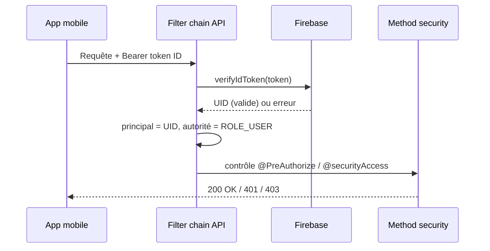
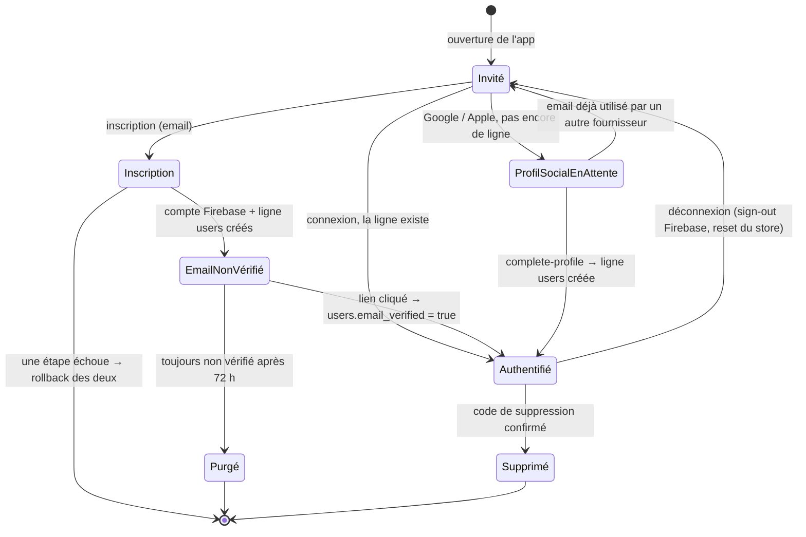
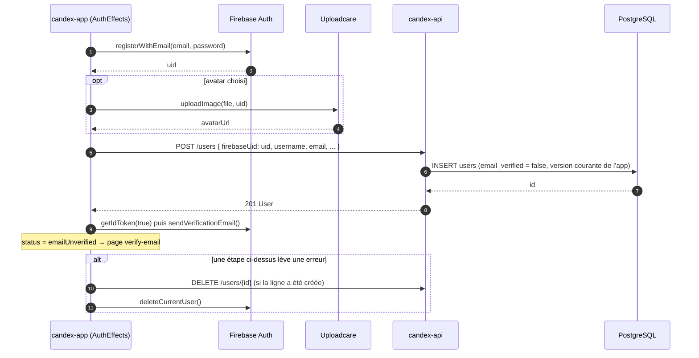
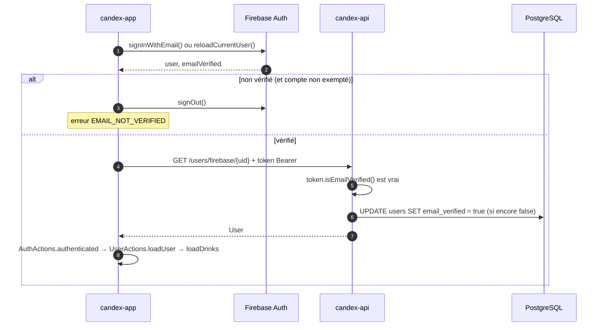

La sécurité est imposée dans l'**API**. L'authentification décide *qui* appelle ; l'autorisation décide *ce qu'*il peut faire. La couche HTTP reste volontairement fine — elle définit le mécanisme d'authentification et quelques routes publiques — tandis que les vraies règles métier vivent dans la method security, à côté des endpoints qu'elles protègent.

## L'authentification d'une requête en un coup d'œil



## Authentification

Deux mécanismes coexistent.

Les **tokens Firebase** sont la voie principale, pour les utilisateurs de l'app. Une requête porte `Authorization: Bearer <token>` ; le `FirebaseAuthenticationFilter` le vérifie (`FirebaseAuth.verifyIdToken`) et, en cas de succès, pose une authentification Spring Security dont le **principal est l'UID Firebase** et l'autorité `ROLE_USER`. La vérification est non bloquante : si le token est absent, invalide, expiré ou révoqué, le filtre vide simplement le contexte et laisse l'autorisation rejeter la requête en aval. Firebase est la source de vérité pour l'identité applicative.

Le filtre entier tient en quelques lignes — notez qu'il ne rejette jamais lui-même une requête :

```java
// FirebaseAuthenticationFilter (a OncePerRequestFilter)
String authorization = request.getHeader("Authorization");

if (authorization != null && authorization.startsWith("Bearer ")) {
    try {
        Authentication authentication =
                firebaseAuthenticationService.authenticate(authorization.substring(7));

        if (authentication != null) {
            SecurityContextHolder.getContext().setAuthentication(authentication);
        }
    } catch (FirebaseAuthException exception) {
        SecurityContextHolder.clearContext(); // token invalide = anonyme, pas une erreur ici
    }
}

filterChain.doFilter(request, response); // @PreAuthorize décide plus tard
```

Une **Basic Auth HTTP interim** couvre l'administrateur. Un magasin d'utilisateurs en mémoire (`InMemoryUserDetailsManager`) contient deux comptes chargés depuis des variables d'environnement — un `user` standard (`ROLE_USER`) et un `admin` (`ROLE_ADMIN`) — avec des mots de passe hashés en BCrypt. Le code la documente comme un pont temporaire, destiné à être remplacé plus tard par une authentification JWT.

La filter chain est **stateless** (`SessionCreationPolicy.STATELESS`), le **CSRF est désactivé** (il n'y a ni session serveur ni cookie à protéger), et le **CORS** est géré par un `CorsFilter` dédié avec une liste d'origines autorisées fixe (`CorsOrigins`).

## Rôles

Il y a deux autorités — `ROLE_USER` et `ROLE_ADMIN` (`SecurityRoles`).

## Autorisation

L'autorisation s'exécute sur deux couches.

**À la couche HTTP** (`SecurityConfig`), seules quelques règles sont déclarées :

- **Public** — `/error`, `/actuator/health`, l'inscription (`POST /users`) et le test d'existence (`GET /users/exists`).
- **Admin uniquement** — l'UI Swagger et la doc OpenAPI (`/swagger-ui/**`, `/v3/api-docs/**`) et l'actuator (`/actuator/**`).
- **Tout le reste** — authentifié.

**À la couche méthode** (`@EnableMethodSecurity`), chaque endpoint porte une règle `@PreAuthorize`, construite à partir de `SecurityExpressions` réutilisables :

- `USER_OR_ADMIN` — tout utilisateur authentifié ou admin.
- `ADMIN_ONLY` — autorité admin requise (écritures du catalogue, imports, opérations d'admin).
- `PERMIT_ALL` — explicitement ouvert.

Les endpoints liés à la propriété passent par le bean `@securityAccess` (`SecurityAccess`) plutôt que par un rôle seul, p. ex. `@PreAuthorize("@securityAccess.canAccessUserId(authentication, #id)")`. La règle est constante : un **admin contourne la propriété**, sinon l'UID Firebase (ou l'id utilisateur) de l'appelant doit correspondre au propriétaire de la ressource. Le même bean garde aussi l'accès par UID Firebase (`canAccessFirebaseUid`) et la gestion des boissons débloquées (`canManageUserUnlockedDrink`).

Dans le code, une route déclare sa règle en une annotation, et la vérification de propriété est une simple méthode Java du bean :

```java
@GetMapping("/{id}")
@PreAuthorize("@securityAccess.canAccessUserId(authentication, #id)")
public ResponseEntity<Result<User>> getUserById(@PathVariable Integer id) { ... }
```

```java
// SecurityAccess
public boolean canAccessUserId(Authentication authentication, Integer userId) {
    if (authentication == null || !authentication.isAuthenticated() || userId == null) {
        return false;
    }

    if (hasAuthority(authentication)) { // ROLE_ADMIN
        return true;
    }

    // Le nom du principal est l'UID Firebase posé par le filtre.
    return Objects.equals(
            userService.getFirebaseUidByUserId(userId),
            authentication.getName()
    );
}
```

`#id` désigne le paramètre de méthode du même nom : la vérification s'exécute avec la valeur de l'URL, avant le corps du contrôleur.

## Cycle de vie d'un utilisateur

Un utilisateur de l'app existe **deux fois** : comme **compte Firebase** (identité, mot de passe, fournisseurs, vérification d'email) et comme **ligne `users` dans PostgreSQL** (profil, collection, rôle dans le domaine). Les deux sont liés par `users.firebase_uid`. Chaque étape du cycle de vie doit les garder synchronisés — l'app orchestre la création (`AuthEffects`), l'API orchestre la suppression (`UserService`, `UnverifiedUserCleanupJob`).



| État | Compte Firebase | Ligne `users` | `AuthStatus` de l'app |
|------|-----------------|---------------|-----------------------|
| Invité | — | — | `guest` / `anonymous` |
| Inscription | en création | en création | `registering` |
| Email non vérifié | existe, `emailVerified = false` | existe, `email_verified = false` | `emailUnverified` |
| Profil social en attente | existe (fournisseur) | — | `socialProfilePending` |
| Authentifié | existe, vérifié | existe | `authenticated` |
| Purgé / Supprimé | supprimé | supprimée | retour à `anonymous` |

### Inscription (email & mot de passe)

L'app crée les deux côtés et **annule les deux** si quoi que ce soit échoue : ni compte Firebase orphelin ni ligne orpheline ne survit à une inscription ratée.



### Vérification, connexion et le drapeau `email_verified`

Firebase possède la vérification ; PostgreSQL en garde une **copie** (affichée dans le dashboard et lue par le job de purge). La copie est synchronisée paresseusement : dès que l'app appelle `GET /users/firebase/{uid}` avec un token dont le claim `email_verified` est vrai, `UserService.getUserByFirebaseUid` passe la ligne à `true`.



La connexion sociale (Google / Apple) passe par le même appel `GET /users/firebase/{uid}` : un `200` connecte l'utilisateur ; un `404` signifie « première fois » — sauf si `GET /users/exists?field=email` indique que l'email est déjà inscrit via un autre fournisseur, auquel cas l'app se déconnecte avec `ACCOUNT_EXISTS_DIFFERENT_PROVIDER` au lieu de créer un doublon.

### Suppression

Les deux chemins de suppression effacent **la ligne d'abord, puis le compte Firebase**, dans une même transaction : si Firebase échoue (hors « utilisateur introuvable »), l'exception annule la suppression de la ligne, les deux ne divergent donc jamais. L'avatar Uploadcare est supprimé en dernier, au mieux.

- **Par l'utilisateur** — `POST /users/me/deletion-code` envoie un code à 6 chiffres par email (haché dans `account_deletion_code`, valable 1 h, 5 essais, 1 renvoi par minute) ; `DELETE /users/me` avec ce code appelle `UserService.deleteUserById`.
- **Par le job de purge** — `UnverifiedUserCleanupJob` tourne chaque jour à 03:30 et cherche les lignes encore `email_verified = false` après 72 h (`candex.security.unverified-user-retention`). Pour chacune, il interroge d'abord Firebase : si l'utilisateur a bien vérifié, le drapeau périmé est resynchronisé et le compte conservé ; sinon les deux côtés sont supprimés. Les comptes listés dans `candex.security.cleanup-protected-emails` sont ignorés.
- **Par un admin** — `DELETE /users/{id}` (`canDeleteUserId`), même chemin `deleteUserById`.

## Secrets

Aucun credential ni clé n'est versionné. Le compte de service Firebase est chargé à l'exécution depuis un chemin de fichier configuré (`candex.firebase.config-path`), jamais depuis le dépôt. Les comptes Basic Auth (`candex.security.*`) et les credentials de la base viennent de variables d'environnement, par profil Spring — les dépôts ne livrent que des fichiers `.env.example` avec des placeholders. Voir [Installation locale](/fr/local-installation/) pour les définir en local et [Déploiement](/fr/deployment/) pour les environnements déployés.

## Côté client

L'app mobile authentifie les utilisateurs avec **Firebase Authentication** et appelle l'API avec le token d'ID obtenu dans l'en-tête `Authorization` ; l'API fait confiance à Firebase pour avoir authentifié l'utilisateur et dérive l'identité du token vérifié. Voir [Architecture](/fr/architecture/) pour la façon dont les pièces s'assemblent.

## Pour aller plus loin

- Les endpoints que ces règles protègent → [API / Contrats](/fr/api-contracts/)
- Les couches derrière → [Back-end](/fr/back-end/)
- La vue d'ensemble → [Architecture](/fr/architecture/)
