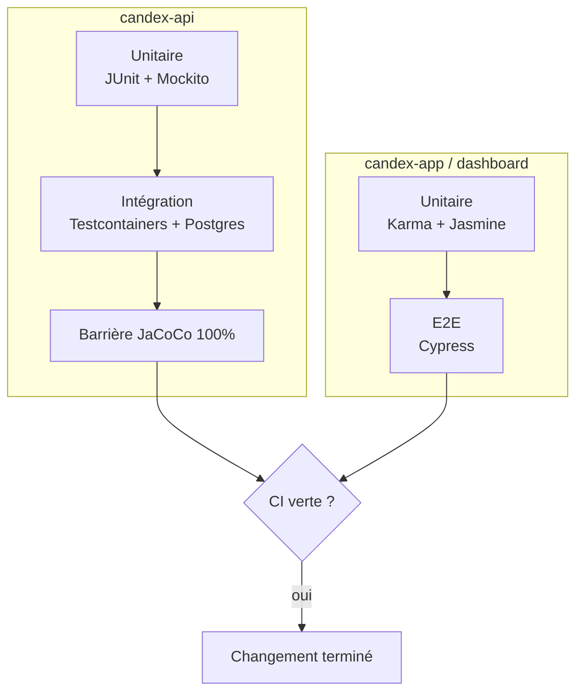

Les tests couvrent toute la stack et sont imposés en CI. Pour l'organisation du code, voir [Back-end](/fr/back-end/) et [Front-end](/fr/front-end/).

## Le dispositif de test en un coup d'œil



## Back-end (`candex-api`)

L'API compte environ **90 classes de test** sur deux niveaux :

- **Tests unitaires** — **JUnit 5** avec **Mockito** pour la logique isolée.
- **Tests d'intégration** — **Testcontainers** démarre un vrai conteneur **PostgreSQL**, de sorte que les tests tournent contre la vraie base plutôt que contre un mock.

La couverture est une barrière stricte : **JaCoCo** impose **100 %** au niveau du bundle (lignes et branches) — le build échoue sous le seuil. **Checkstyle** impose le style de code.

```bash
./mvnw test        # lance les tests
./mvnw verify      # tests + barrière de couverture JaCoCo + Checkstyle
```

## Front-ends (`candex-app`, `candex-dashboard`)

Les deux applications Angular utilisent **Karma + Jasmine** pour les tests unitaires, lancés en mode headless avec couverture. Les specs vivent à côté du code (`*.spec.ts`) — environ **80** dans l'app et **40** dans le dashboard. L'app mobile a aussi **Cypress** pour les tests de bout en bout.

```bash
npm run test       # mode watch, avec couverture
npm run test:ci    # headless (ChromeHeadless), une passe, avec couverture
```

## Intégration continue

Chaque push et chaque pull request lance un **quality gate** (`.github/workflows/ci.yml`) par dépôt :

| Dépôt | Ce que la CI exécute |
|-------|----------------------|
| `candex-api` | `mvn clean verify checkstyle:checkstyle` (tests + barrière JaCoCo 100 % + Checkstyle), puis un build d'image Docker ; publie les rapports Checkstyle et JaCoCo |
| `candex-app` · `candex-dashboard` | `ng test` headless avec couverture, plus le lint |

**Qodana** ajoute une analyse statique de qualité de code par-dessus.

## Conventions

Les tests épousent le code qu'ils couvrent, à chaque niveau :

- **Une unité par fichier** — une classe de test (API) ou un `describe` racine (front) par classe ou service, nommé d'après elle : `@DisplayName("ColorMatcher")`, `describe('SettingsActionsService')`.
- **Une méthode par groupe** — chaque méthode testée a sa propre classe `@Nested` côté API (`@DisplayName("findNearestAnchor()")`) ou un `describe('refreshProviderState()')` imbriqué côté front.
- **Un cas par test** — un seul `@Test` / `it` par scénario, nommé comme le comportement qu'il vérifie (*« should return semantic match when a ColorGroup zone matches »*, *« dispatches linkGoogle when not yet linked »*). Côté API chaque niveau porte un `@DisplayName`, si bien que le rapport de tests se lit comme des phrases.
- **Un smoke test par fichier** — `contextLoads()` (*« should load correctly »*) côté API, `it('should be created')` côté front, pour qu'une erreur de câblage ou d'injection remonte en premier.
- **Des fixtures partagées, pas d'objets recréés** — les données de test réutilisables vivent à un seul endroit et sont importées, jamais reconstruites dans chaque fichier : le package `util/test/fixture` de l'API (`TestApp`, `TestEntity`, `TestGetDTO`, `TestPostDTO` — classes `final` exposant des constantes figées comme `FIXED_NOW` et des entités/DTOs préparés), et côté front `utils/tests/mocks.ts` et les test helpers (dashboard : `tests/mocks`).

Et sur toute la stack :

- Les tests vivent **à côté du code** qu'ils couvrent (`*.spec.ts` ; `*Test` sur l'API).
- Les tests d'intégration utilisent **Testcontainers**, pas des mocks : ils exercent du vrai SQL et les vraies migrations.
- La barrière de **100 % de couverture** de l'API implique que tout nouveau code arrive avec ses tests — et un changement n'est pas terminé tant que la CI n'est pas verte.

### À quoi ressemble un test

Un test unitaire de l'API, tiré de `BrandServiceTest` : le service est construit avec des collaborateurs mockés, les fixtures (`B_ENTITY_LIST`, `B1`…) viennent de `util/test/fixture`, et `verifyNoMoreInteractions` prouve que le service n'a rien fait de plus que prévu :

```java
@ExtendWith(MockitoExtension.class)
@DisplayName("BrandService")
class BrandServiceTest {

    @Mock private BrandRepository brandRepository;
    @Mock private BrandMapper brandMapper;

    @InjectMocks
    private BrandService brandService;

    @Nested
    @DisplayName("getAllBrands()")
    class GetAllBrands {

        @Test
        @DisplayName("should return all brands as DTOs")
        void shouldReturnAllBrands() {
            // Arrange
            when(brandRepository.getAllBrandsOrderedById()).thenReturn(B_ENTITY_LIST);
            when(brandMapper.toDTO(B_ENTITY_LIST)).thenReturn(B_LIST);

            // Act & Assert
            assertThat(brandService.getAllBrands())
                    .hasSize(3)
                    .containsExactly(B1, B2, B3);

            verify(brandRepository).getAllBrandsOrderedById();
            verify(brandMapper).toDTO(B_ENTITY_LIST);
            verifyNoMoreInteractions(brandRepository, brandMapper);
        }
    }
}
```

Un test de reducer front-end, tiré de `user.reducer.spec.ts`. Les reducers sont des fonctions pures, donc pas besoin de `TestBed` — on l'appelle avec un état et une action, et on vérifie l'état qui en sort :

```ts
describe('tasteDrinkSuccess()', () => {
  it('should add the owned drink to the collection', () => {
    // Arrange
    const action = DrinkActions.tasteDrinkSuccess({
      drinkId: 2,
      unlockedAt: '2026-04-18T20:52:52.110917Z',
    });

    // Act
    const state = userReducer(initialUserState, action);

    // Assert
    expect(state.ownedDrinks.entities[2]).toEqual({
      drinkId: 2,
      unlockedAt: '2026-04-18T20:52:52.110917Z',
    });
    expect(state.error).toBeNull();
  });
});
```

## Pour aller plus loin

- Style de code, conventions, analyse statique → [Qualité logicielle](/fr/software-quality/)
- L'API → [Back-end](/fr/back-end/) · Les front-ends → [Front-end](/fr/front-end/)
